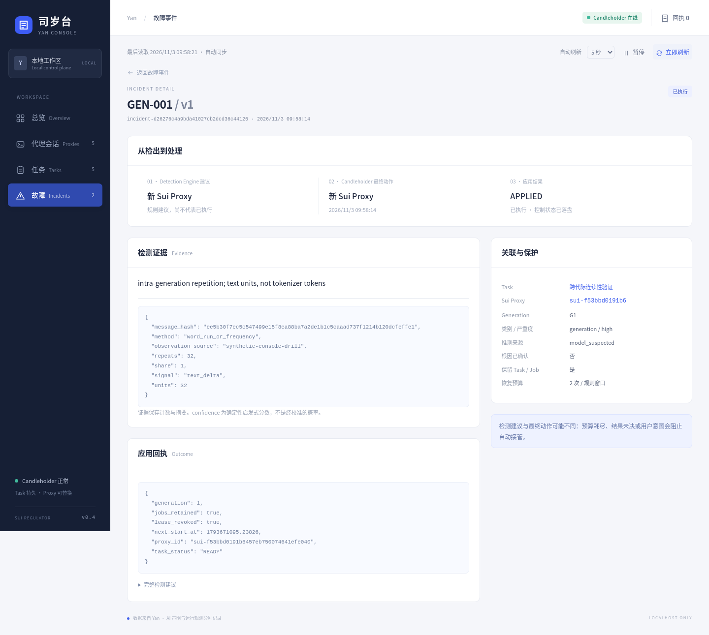
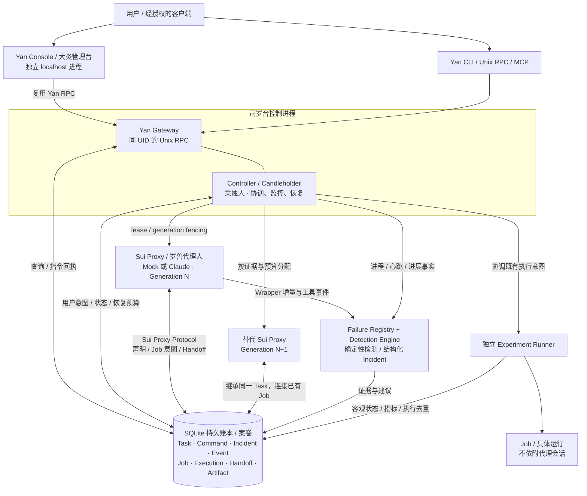

# Sui Regulator（司岁台）

**持久 Task、可替换的 Sui Proxy、独立运行的 Job。**

司岁台是独立于 AI 会话的本地任务控制平面。它把用户意图、AI 声明和 Runner 的真实观测分别记录，让秉烛人在代理失效时按证据与预算恢复任务，让大炎入口随时可查询、可干预。

v0.4 提供 **Yan Console**：四个本地 Web 页面，用来观察代理身份与换代、Task/Job、故障证据、自动恢复及人工指令回执。Python 3.11+ / Linux，运行时仅用标准库；前端为原生 HTML/CSS/JavaScript，无框架、CDN 或 npm 构建依赖。当前执行端只运行合成 Job，真实 GLM、GPU/NPU 与远程 Runner 尚未验证。

**另一台服务器从克隆到部署：** 见 [部署与验收指南](docs/DEPLOYMENT.md)，包括固定版本安装、持久状态、systemd 用户服务、SSH 访问、Mock/GLM 验收、备份与升级回滚；[服务模板](deploy/systemd/user/sui-regulator-controller.service) 随仓库提供。

## 命名与世界观

项目借用《明日方舟》大炎、司岁台与岁兽的意象，并保留清晰的工程概念。

| 名称 | 英文 | 在系统中的职责 |
|---|---|---|
| 司岁台 | Sui Regulator | 总体控制与编排系统，持久保存任务、指令、所有权和恢复记录 |
| 大炎 | Yan | 人与外部客户端提交指令、查询事实的入口；Yan Console 是本地 Web 管理台 |
| **岁兽代理人** | **Sui Proxy** | 可替换的 AI 会话执行者，领取 Task、报告进度、连接已有 Job |
| 秉烛人 | Candleholder | 不依赖 LLM 的监控与恢复程序，发现故障、撤销旧 lease、分配新代际 |
| 任务 | Task | 跨代理代际存在的目标、用户意图和执行关系 |
| 敕令 | Edict / Command | 可幂等提交、可查询 Receipt 的人工指令，内部统一称 Command |
| 试验 | Trial / Experiment / Job | Trial 是展示意象；Experiment 保存定义，Job 是一次具体运行 |
| 案卷 | Dossier | Task 的事件、故障、产物与交接记录的整体意象，不另建重复存储 |
| 移交 | Handoff | 代理更替时的结构化交接；缺失时仍可通过账本接管 |

**表示 AI 会话角色时统一使用 Sui Proxy（岁兽代理人）**。Session 仅表示其会话实例，Generation 表示同一 Task 的代理所有权代际。Task、Command、Job 等工程名称保持明确；代理被替换不会让原有 Task 消失，也不授权重放已开始的 Job。

兼容 v0.3 的 workers/worker_id 等持久字段、旧导入和事件类型仍保留，避免重写历史或破坏运行中关系。规范代码入口采用 SuiProxyAdapter、ProxyRegistry、ProxyCredentials、SuiProxyProtocol、proxy_process；健康查询使用 `yan.get_proxy_health`，配置示例使用 `max_proxies`。详见 [命名与兼容约定](docs/NAMING.md)。

## 先看一个完整演示

在仓库根目录运行，无需模型 API 或 Claude：

```bash
PYTHONPATH=src python3.11 -m sui_regulator console-demo --port 8765
```

打开 **http://127.0.0.1:8765**。演示创建隔离状态目录、独立 Controller、独立 Console 和专用合成进程，可观察：

- 第一代 Sui Proxy 出现 GEN-001 文本退化，Candleholder 检测并撤销其 lease，新代际接管同一 Task。
- 原 Job ID/PID 保留，execution 仍为一条；独立 Runner 继续产生真实的合成 step/loss 指标。
- Job UNKNOWN、历史完成、暂停任务及正常 Handoff/换代。
- 从 Task 详情 Hold、Resume、追加指令，查看真实 Command Receipt；Hold 需要明确确认。

演示工具退出时清理自己登记的专用进程，拒绝使用任何已有状态目录。普通 Console 退出不影响 Controller、代理或 Job。可用 `--state-dir /tmp/yan-console-new-demo` 保留演示账本，目录必须不存在。

## Yan Console

| 页面 | 可查看与操作 |
|---|---|
| Overview / 总览 | 全局计数、最近故障、控制事件、Candleholder tick 和最后数据时间 |
| Sui Proxies / 代理会话 | 所有代际分页，身份、Generation、心跳、最后活动、时长、冻结/失联、Task、故障和 Handoff |
| Tasks / 持久任务 | Desired、Declared（未核验 AI 声明）、Observed（Runner 观测）分别显示；Job、指标、执行记录和人工干预 |
| Incidents / 故障事件 | 规则版本、证据、检测建议、Candleholder 最终动作、应用状态及回执 |

自动刷新可限频、暂停和手动触发，隐藏标签页停止轮询，错误时退避。Controller 离线或 tick 过期时显示最后快照及原时间戳，不维持绿色实时状态，停用人工操作。Console 通过已有 Unix RPC 工作，不打开 SQLite，不直接杀进程。没有聊天、任意 Shell、公网控制端口或新的身份体系。

<details>
<summary>查看真实浏览器截图</summary>




更多：[代理详情](docs/screenshots/proxy-detail.png) · [Task 与指标](docs/screenshots/task-detail.png) · [命令回执](docs/screenshots/command-receipts.png) · [Controller 离线](docs/screenshots/controller-offline.png) · [移动视口](docs/screenshots/mobile.png)

</details>

## 整体架构



Controller 与 Candleholder 是同一独立控制进程中的协调与监控职责；Yan Gateway 在该进程提供本地 RPC。Console、各 Sui Proxy 与 Runner 独立运行。Sui Proxy 所有权在写事务内校验，Runner 在启动和取消副作用处再次核验授权；结果不明的执行保留 UNKNOWN，不据超时盲目重发。

## 连接自己的本地账本

```bash
export PYTHONPATH="$PWD/src"
python3.11 -m sui_regulator --home .sui init
python3.11 -m sui_regulator --home .sui serve
# 另一终端：
python3.11 -m sui_regulator --home .sui console --port 8765
# 再提交一个合成任务：
python3.11 -m sui_regulator --home .sui submit '合成指标观测' --key trial-1 --spec '{"steps":1000,"interval":0.1}'
```

只绑定 127.0.0.1。经授权的 SSH 访问可在本机使用 `ssh -N -L 127.0.0.1:8765:127.0.0.1:8765 YOUR_AUTHORIZED_HOST`，然后打开本机端口。详见 [运行、演示与 SSH 指南](docs/YAN_CONSOLE.md)。同源保护不等于多用户鉴权，部署边界为可信本机与经授权的端口转发。

## 故障检测与恢复

13 条版本化规则、40 条正反例轨迹可完全离线重放，覆盖生成重复、非法工具结构、相同失败循环、传输错误/断流/静默、进程与 lease、会话冲突、进展和未知异常。建议动作包括告警、只读探测、有限重试、新代理、等待和隔离；最终决策受人工意图、规则/全局预算与未决 Job 约束。

```bash
PYTHONPATH=src python3.11 -m sui_regulator failures list
PYTHONPATH=src python3.11 -m sui_regulator failures evaluate tests/failure_corpus --summary
PYTHONPATH=src python3.11 -m sui_regulator --home .sui rpc yan.get_incidents --params '{"task_id":"TASK_ID","after":0,"limit":100}'
```

当前回归集 23 条故障全部检出，17 条正常轨迹无告警；这不估计真实 GLM 的召回率或误报率。真实 Claude CLI 已在本地假 API 上验证 text_delta 观察和生成结束前的重复拦截；未收到增量时只显示 event-only，不宣称逐 tokenizer token 监控或语义质量判断。

## 安装与验证

```bash
python3.11 -m venv .venv
.venv/bin/python -m pip install -e .
.venv/bin/yan console-demo --port 8765

# 标准库 / SQLite / 专用进程测试，无 API：
PYTHONPATH=src python3.11 -m unittest discover -s tests -v
# 安装真实 CLI 并测试本地假 Messages API：
python3.11 scripts/install_claude.py
SUI_TEST_REAL_CLAUDE=1 PYTHONPATH=src python3.11 -m unittest discover -s tests -v
# 可选浏览器验收工具，不是 Console 运行依赖：
.venv/bin/python -m pip install playwright
PYTHONPATH=src .venv/bin/python scripts/verify_console_browser.py --browser /usr/bin/chromium-browser
python3.11 scripts/export_schemas.py --check
```

Claude 安装器校验官方原生包 integrity，不需要 Node、npm 或 root；已验证版本 2.1.316。真实平台的端点、鉴权、GLM dialect、长时间行为、训练生命周期、持久卷和远程授权仍需接续验证。默认仅开放受管 MCP 和合成 Job，不提供任意真实训练执行或终止。

## 文档与边界

- [新服务器部署与测试](docs/DEPLOYMENT.md)、[Controller 服务](deploy/systemd/user/sui-regulator-controller.service)、[Console 服务](deploy/systemd/user/yan-console.service)
- [Yan Console 使用与演示](docs/YAN_CONSOLE.md)、[命名体系与兼容](docs/NAMING.md)、[v0.4 实施依据](docs/YAN_CONSOLE_PLAN.md)
- [架构](docs/ARCHITECTURE.md)、[数据模型](docs/DATA_MODEL.md)、[Sui Proxy Protocol](docs/SUI_PROTOCOL.md)、[Yan API](docs/YAN_API.md)
- [故障调查](docs/FAILURE_RESEARCH.md)、[检测架构](docs/FAILURE_ARCHITECTURE.md)、[故障贡献步骤](docs/FAILURE_CONTRIBUTING.md)、[Incident Corpus](tests/failure_corpus/README.md)
- [恢复策略](docs/RECOVERY_POLICY.md)、[安全边界](docs/SECURITY.md)、[结构化进度](docs/PROGRESS.json)
- [v0.3 验收](docs/FAILURE_VALIDATION.md)、[首轮交付历史](docs/DELIVERY.md)、[浏览器报告](docs/console-browser-report.json)

当前是 Linux 单 UID、本地 SQLite、单 Controller 的可运行原型；没有远程 SaaS、分布式控制、多租户或 GPU 调度。Task 的完成声明不自动证明科研结论，指令回执成功只证明该指令定义的效果已应用。历史需求与验收证据保留原术语，当前角色约定以 Sui Proxy 为准。

MIT License。开发与演示仅操作隔离状态目录、专用进程和合成数据，不连接公司数据或操作现有训练。
