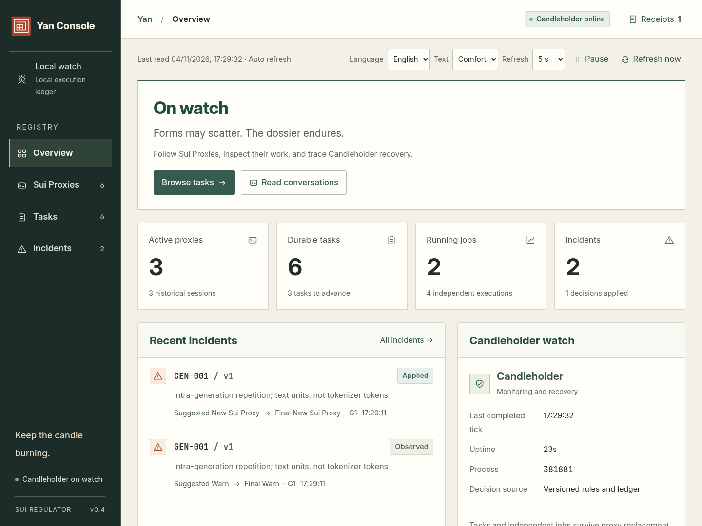
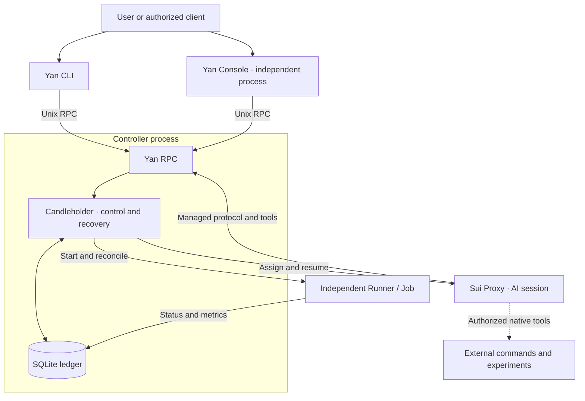

# Sui Regulator

**English** · [简体中文](README.zh-CN.md)

A local runtime and recovery framework for long-running AI tasks.

Sui Regulator manages durable tasks, replaceable AI sessions, and independent jobs as separate lifecycles. You define the goals and permissions. The **Sui Proxy** analyzes, writes code, debugs, and decides what to do next. **Candleholder** handles runtime failure detection, session recovery, execution records, and operator controls. Task requirements, instructions, and handoffs remain available after a session exits or is replaced.

[Deployment](docs/DEPLOYMENT.md) · [Writing task briefs](docs/TASK_BRIEFS.md) · [Console guide](docs/YAN_CONSOLE.md) · [Documentation](docs/README.md) · [Project lore](docs/LORE.md#sui-regulator)

## Capabilities

- **Trusted autonomy**: opt into `--permission-mode trusted` for unattended execution. Unknown receipts and background work do not lock other tools. Healthy sessions retain their process and conversation across turns and timed waits; runtime failures retry automatically. See the [unattended operation guide](docs/TRUSTED_AUTONOMY.md).
- **Durable tasks**: preserve complete Markdown briefs, acceptance criteria, execution profiles, additional instructions, generation history, and Handoffs. Proxies can register a wait, resume when it expires, and submit a completion marker.
- **Session recovery**: respond to runtime evidence such as process failures, broken connections, lost ownership, and anomalies in generated output. Persistent and Bounded recovery modes are available. Failed experiments, normal debugging, and a lack of new observations alone are not treated as session failures.
- **Auditable controls**: Hold, Resume, and Instruct produce persistent Command Receipts. Desired, Declared, and Observed State remain separate, distinguishing operator intent, proxy claims, and runtime observations.
- **Yan Console**: an independent local management process with Overview, Sui Proxies, Tasks, and Incidents pages. It supports English and Chinese, Markdown, distinct conversation roles, collapsible tool records, incident markers, and offline snapshots.
- **A demo without a model API**: Mock proxies and synthetic Jobs demonstrate GEN-001 detection, session replacement, continuity of the same Task, prevention of duplicate Job starts, and real operator command receipts.

Version **v0.4** targets Linux, Python 3.11+, and deployment under one OS user with one Controller. The Python runtime uses the standard library. The frontend uses HTML, CSS, and JavaScript, with bundled fonts and Markdown dependencies; no npm build or CDN is required.

<details>
<summary>Yan Console preview</summary>



[Conversation roles and collapsed tools](docs/screenshots/yan-reader/conversation-roles-en.png)

</details>

## Architecture and responsibilities



A Task outlives its sessions; managed Jobs can also survive proxy replacement. Console queries and commands go through Yan. Stopping Console does not stop the Controller or its Jobs. Candleholder implements control and recovery within the Controller; it does not judge the substance of a task.

**The managed Runner currently supports synthetic Jobs only.** With the `claude_code` execution profile, a proxy can use native tools to edit code, run commands, and conduct experiments. Work launched through Bash, SSH, or external scripts does not automatically become a managed Job. Duplicate prevention, process survival, and remote status must be verified through the actual execution interface. See the [architecture](docs/ARCHITECTURE.md) and [task brief guide](docs/TASK_BRIEFS.md) for these boundaries.

## Quick start

On Linux, with Git, Python 3.11+, and venv available:

```bash
git clone https://github.com/RabbitEG/sui_regulator.git
cd sui_regulator
python3.11 -m venv .venv
.venv/bin/python -m pip install .
.venv/bin/yan console-demo --port 8765
```

Open **http://127.0.0.1:8765** and select English in the language menu. The demo creates isolated temporary state, a Controller, a Console, and synthetic processes. No model API is needed. Open the task demonstrating recovery across generations to inspect GEN-001, the old and new proxies, and the retained Job/PID. Try Hold, Resume, and additional instructions. Ctrl+C cleans up processes created by this demo.

Use `console-demo` for demonstrations. For persistent deployment, follow the [deployment guide](docs/DEPLOYMENT.md) to install a pinned revision, configure a state directory, and run the Controller and Console as separate services. Console binds to localhost by default. Remote access uses authorized SSH port forwarding:

```bash
ssh -N -L 127.0.0.1:8765:127.0.0.1:8765 YOUR_AUTHORIZED_HOST
```

## Define your task

Once Claude Code and its model service are configured, create a task in Console or submit a complete Markdown brief through the CLI:

```bash
.venv/bin/yan --home /absolute/private/state submit 'Verify the current experiment and continue debugging' \
  --adapter claude --execution-profile claude_code \
  --workspace /absolute/project \
  --objective-file /absolute/task-brief.md \
  --completion-criteria 'Save verification results, a change summary, and artifact paths'
```

Describe the goal, existing work, permitted environments and tools, completion criteria, and stop conditions. A brief can specify an entire sequence: wait for the current experiment, verify its results, diagnose and fix problems, rerun checks, and continue with the next experiment. The proxy decides how to carry out that work; the framework does not replace it with a fixed watchdog routine.

The default execution profile is `managed`. Code changes and native commands require an explicit choice of `claude_code`, which uses the service account's permissions; `--workspace` is not a filesystem sandbox. Mock proxies demonstrate control behavior and do not interpret or execute real task briefs. Prompt structure, examples, completion markers, and optional acceptance scripts are documented in [task briefs and execution profiles](docs/TASK_BRIEFS.md) and [prompt and lifecycle design](docs/PROMPT_AND_LIFECYCLE_DESIGN.md).

## Documentation and validation

The detailed engineering guides below are currently written in Chinese.

| Topic | Guide |
|---|---|
| Server deployment, upgrades, backups, and rollback | [Deployment and acceptance](docs/DEPLOYMENT.md) |
| Local demos, installation, and development checks | [Project overview](docs/PROJECT_OVERVIEW.md) |
| Console pages, operator controls, and conversation reading | [Yan Console](docs/YAN_CONSOLE.md) |
| Responsibilities, persistence, and state sources | [Responsibility baseline](docs/RESPONSIBILITY_BASELINE.md) · [Data model](docs/DATA_MODEL.md) |
| Queries, commands, receipts, and proxy continuity | [Yan API](docs/YAN_API.md) · [Sui Proxy Protocol](docs/SUI_PROTOCOL.md) |
| Git-based task briefs, instructions, receipts and reports | [Git Bridge deployment](docs/GIT_INSTANCES.md) |
| Failure evidence and recovery policies | [Persistent recovery](docs/PERSISTENT_RECOVERY.md) · [Failure detection](docs/FAILURE_ARCHITECTURE.md) |
| All documentation, tests, and delivery records | [Documentation index](docs/README.md) |

Run tests and replay the failure corpus from the source checkout without a real model API:

```bash
PYTHONPATH=src .venv/bin/python -m unittest discover -s tests -v
PYTHONPATH=src .venv/bin/python -m sui_regulator failures evaluate tests/failure_corpus --summary
```

Validation covers local control behavior, synthetic failures, browser interactions, and the real Claude Code CLI connected to a local mock API. Long-running behavior with real GLM, deployment on the target server, and real experiment lifecycles still require testing in that environment. Simulations do not establish a model's research or diagnostic ability.

## Project lore and license

Sui Regulator, Yan, Sui Proxy, Candleholder, and Dossier belong to the project's narrative setting. The story and its English translation live in [LORE.md](docs/LORE.md#sui-regulator); [project terminology](docs/NAMING.md) maps these names to engineering responsibilities.

Project code is licensed under the [MIT License](LICENSE). Bundled fonts, Markdown libraries, and other third-party code retain their own licenses; see [Third-party notices](THIRD_PARTY_NOTICES.md).
