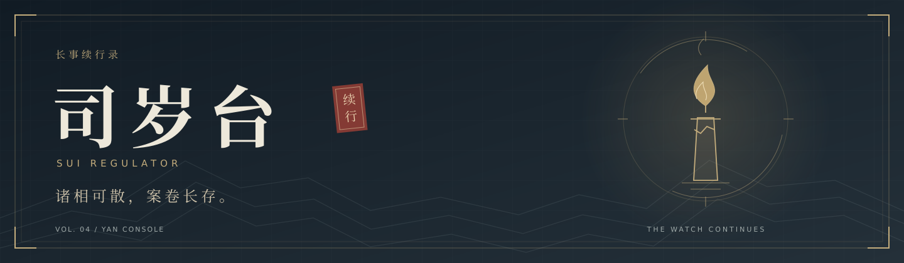
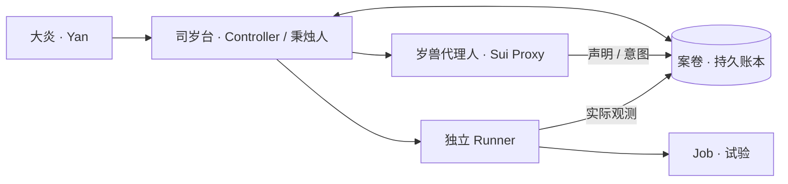
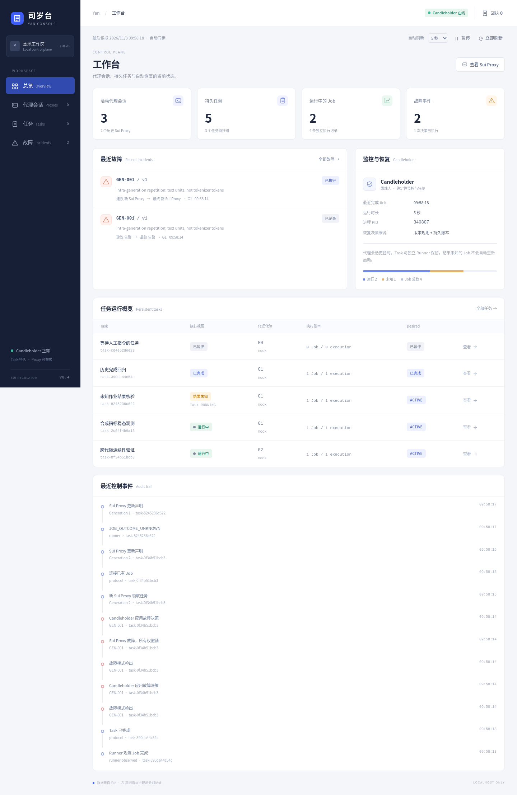

# 司岁台 · Sui Regulator



<p align="center">
  <b>长事续行录 · 卷四 / Yan Console</b><br>
  <a href="docs/PROJECT_OVERVIEW.md">入台须知</a> ·
  <a href="docs/DEPLOYMENT.md">异地设台</a> ·
  <a href="docs/README.md">案卷目录</a> ·
  <a href="docs/LORE_AND_REFERENCES.md">典故考据</a>
</p>

> 秉明烛者，岂苦夜长。
>
> ——《明日方舟》左乐模组「岂苦夜长」，[PRTS 转录](https://prts.wiki/w/左乐#模组)

## 序 · 长事未竟

夜已三更，试验仍在运行。

案前的代理人却开始重复同一句话。继而失去回应，最后，连会话也归于寂静。

可你的任务尚未完成。已下的指令、走过的步骤、仍在运行的作业，总得有人记住。

于是设台存卷，遣人秉烛。**代理可以更替，长事仍有来处。**

**司岁台是一个独立于 AI 会话的本地任务控制平面：保存持久 Task，监测可替换的 Sui Proxy（岁兽代理人），让独立 Job 跨会话继续运行，并留下可查询的恢复记录。**

## 壹 · 台中诸职

| 名号 | 所司之事 |
|---|---|
| **大炎 · Yan** | 受令、问事。CLI、RPC 与 Yan Console 共用同一入口。 |
| **岁兽代理人 · Sui Proxy** | 领任务、报进展、连接作业。此任有代际，案卷有后继。 |
| **秉烛人 · Candleholder** | 察异、存证、核定恢复；受预算与人工意图约束。 |
| **案卷 · Dossier** | Task 的事件、故障、产物与移交记录，供后来者接续。 |
| **试验 · Job** | 由独立 Runner 执行；代理离席，已启动的受管作业仍可继续。 |

角色与兼容字段的完整约定，收入[名籍](docs/NAMING.md)。

## 贰 · 台规三则

**一曰，敕令入卷。** Hold、Resume 与追加指令有账可查、有回执可核。用户意图先于自动恢复。

**二曰，换人续事。** 旧代理失去所有权，新代际接续同一 Task，先核验已有 Job。

**三曰，疑事留验。** AI 自述与实际观测分列。作业结果不明，就记 UNKNOWN，待核实后再行处置。



此为职责简图；[完整架构卷](docs/ARCHITECTURE.md)另录进程边界、所有权与副作用授权。

## 叁 · 换代值录

下列为 Mock 演示中的恢复流程示意：

```text
一更  GEN-001：第一代代理出现重复生成，检测证据入卷。
二更  秉烛人核定恢复：撤销旧 lease，核验已有作业。
三更  第二代 Sui Proxy 接任：Task 未改，Job 未重开。
天明  原 Runner 仍在，执行记录仍为一条。
```

卷四所增 **Yan Console**，可纵览台中任务、代理代际与故障处置，也可亲下敕令，核对回执。

[](docs/YAN_CONSOLE.md)

## 肆 · 开台验卷

在 Linux / Python 3.11+ 的仓库根目录，运行一场无需模型 API 的合成演示：

```bash
PYTHONPATH=src python3.11 -m sui_regulator console-demo --port 8765
```

打开 <http://127.0.0.1:8765>。可见故障、换代、独立作业与人工回执；Ctrl+C 收场时清理演示专用进程。[演示说明](docs/YAN_CONSOLE.md) · [安装与验证](docs/PROJECT_OVERVIEW.md) · [另一台服务器部署](docs/DEPLOYMENT.md)

## 终 · 案卷在此

| 欲问之事 | 所赴之卷 |
|---|---|
| 初来此台，如何运行 | [项目概览](docs/PROJECT_OVERVIEW.md) · [Console 使用](docs/YAN_CONSOLE.md) |
| 易地设台，如何值守 | [部署、验收、备份与回滚](docs/DEPLOYMENT.md) |
| 内里机杼，如何接续 | [架构](docs/ARCHITECTURE.md) · [数据模型](docs/DATA_MODEL.md) · [协议与 API](docs/README.md#接口与实现) |
| 何以察异，何以复任 | [故障检测](docs/FAILURE_ARCHITECTURE.md) · [恢复策略](docs/RECOVERY_POLICY.md) |
| 今日所成，何处为证 | [v0.4 验收](docs/YAN_CONSOLE_DELIVERY.md) · [安全边界](docs/SECURITY.md) |
| 名从何来，文有所本 | [命名体系](docs/NAMING.md) · [资料与风格参考](docs/LORE_AND_REFERENCES.md) |

当前为 **v0.4 本地原型**，执行端以合成 Job 验证；真实 GLM、GPU/NPU 与远程 Runner 待实平台测试。完整工程文档从[案卷目录](docs/README.md)进入。

---

独立开源项目，世界观命名取意于《明日方舟》。封面与项目叙述为原创，典故与工程改编见[考据卷](docs/LORE_AND_REFERENCES.md)。[MIT License](LICENSE)
