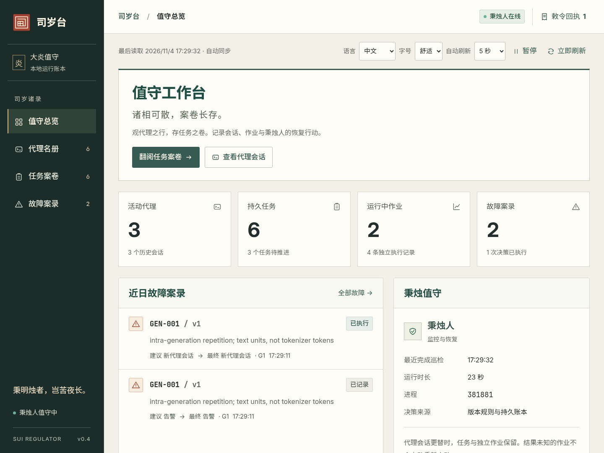
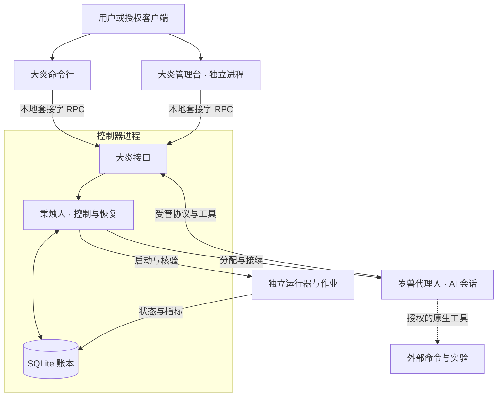

# 司岁台

[English](README.md) · **简体中文**

司岁台（Sui Regulator）是一套面向长期任务的本地 AI 运行与接续框架。

司岁台将持久任务、可替换的 AI 会话和独立作业分开管理。用户定义完整目标与授权，**岁兽代理人（Sui Proxy）**负责分析、编程、调试和选择下一步，**秉烛人（Candleholder）**负责运行故障检测、会话接续、执行记录与人工控制。会话退出或换代后，任务要求、历史指令和交接资料仍然保留。

[部署指南](docs/DEPLOYMENT.md) · [如何写任务书](docs/TASK_BRIEFS.md) · [控制台使用](docs/YAN_CONSOLE.md) · [文档目录](docs/README.md) · [项目世界观](docs/LORE.md#司岁台)

## 当前能力

- **持久任务**：保存完整 Markdown 任务书、验收条件、执行能力、追加指令、代际历史与交接记录；支持代理登记等待、到期接续和提交完成标记。
- **会话恢复**：根据进程、连接、所有权与生成异常等运行证据处理故障，支持持续恢复和有限恢复两种模式。实验失败、正常调试和单纯缺少新观测不会被当作会话失败。
- **可核验的控制**：暂停、恢复、追加指令等人工操作有持久回执；用户意图、代理声明和运行观测分别记录。
- **本地管理台**：Yan Console 独立运行，提供总览、代理会话、任务和故障四个页面；支持中英文切换、Markdown 阅读、角色区分、工具折叠、故障定位和离线快照。
- **无需模型的演示**：用模拟代理和合成作业演示 GEN-001 检测、代理换代、同一任务接续、作业不重复启动及真实人工操作回执。

当前版本 **v0.4**，面向 Linux、Python 3.11+、单用户和单控制器部署。Python 运行时使用标准库；前端为原生 HTML/CSS/JavaScript，字体和 Markdown 依赖随包提供，无需 npm 构建或 CDN。

<details>
<summary>管理台界面</summary>



[会话角色与工具折叠](docs/screenshots/yan-reader/conversation-roles-zh.png)

</details>

## 架构与职责



任务的生命周期独立于会话；受管作业也可以跨代理代际运行。管理台通过大炎接口查询和提交指令，停止管理台不会停止控制器或作业。秉烛人是控制器中的监控与恢复职责，不裁判任务的工作内容。

**当前托管运行器只实现合成作业。** 启用 `claude_code` 后，代理可以用原生工具修改代码、运行命令和实验；通过 Bash、SSH 或外部脚本启动的工作不会自动变成托管作业。它们的去重、存活与远端状态必须按实际执行接口核验。具体边界见[整体架构](docs/ARCHITECTURE.md)与[任务书指南](docs/TASK_BRIEFS.md)。

## 快速开始

准备 Git、Python 3.11+ 和 venv，在 Linux 上执行：

```bash
git clone https://github.com/RabbitEG/sui_regulator.git
cd sui_regulator
python3.11 -m venv .venv
.venv/bin/python -m pip install .
.venv/bin/yan console-demo --port 8765
```

打开 **http://127.0.0.1:8765**，在语言菜单选择中文。演示会创建隔离的临时状态、控制器、管理台和合成进程，不需要模型 API。进入“跨代际连续性验证”任务，可以检查 GEN-001、旧代理与新代理、保留的作业及其进程编号，并尝试暂停、恢复和追加指令。Ctrl+C 清理该演示创建的进程。

`console-demo` 用于演示；持久部署请按[部署指南](docs/DEPLOYMENT.md)安装固定版本、配置状态目录并启动控制器与管理台两个服务。默认只监听本机，远程访问使用经授权的 SSH 端口转发：

```bash
ssh -N -L 127.0.0.1:8765:127.0.0.1:8765 YOUR_AUTHORIZED_HOST
```

## 定义自己的任务

部署并配置好 Claude Code 及其模型服务后，在管理台中创建任务，或通过命令行提交完整 Markdown 文件：

```bash
.venv/bin/yan --home /absolute/private/state submit '核验当前实验并继续调试' \
  --adapter claude --execution-profile claude_code \
  --workspace /absolute/project \
  --objective-file /absolute/task-brief.md \
  --completion-criteria '保存核验结果、修改说明和产物路径'
```

任务书应写清目标、已有工作、允许使用的环境与工具、完成条件和停止边界。例如“等待现有实验结束 → 核验结果 → 分析并修复问题 → 复测 → 继续下一轮实验”可以完整写入，由代理自主执行。框架不会把它改写为固定巡检流程。

`managed` 是默认执行能力；代码修改与原生命令需要明确选择 `claude_code`，其权限来自服务账户，`--workspace` 不是文件系统沙箱。模拟代理用于演示控制行为，不会理解和完成真实任务书。提示词结构、示例、完成标记和可选验收脚本见[任务书与执行能力](docs/TASK_BRIEFS.md)及[提示词与生命周期设计](docs/PROMPT_AND_LIFECYCLE_DESIGN.md)。

## 文档与验证

| 内容 | 入口 |
|---|---|
| 新服务器部署、升级、备份与回滚 | [部署与验收](docs/DEPLOYMENT.md) |
| 本地演示、安装与开发验证 | [项目概览](docs/PROJECT_OVERVIEW.md) |
| 四个页面、人工干预与会话阅读 | [管理台指南](docs/YAN_CONSOLE.md) |
| 职责边界、持久化与状态来源 | [职责基线](docs/RESPONSIBILITY_BASELINE.md) · [数据模型](docs/DATA_MODEL.md) |
| 查询、指令、回执与代理接续 | [大炎接口](docs/YAN_API.md) · [岁兽代理人协议](docs/SUI_PROTOCOL.md) |
| 故障证据与恢复策略 | [持续恢复](docs/PERSISTENT_RECOVERY.md) · [检测架构](docs/FAILURE_ARCHITECTURE.md) |
| 全部文档、测试与历史交付记录 | [文档目录](docs/README.md) |

在源码目录运行不依赖真实模型的测试和故障语料回放：

```bash
PYTHONPATH=src .venv/bin/python -m unittest discover -s tests -v
PYTHONPATH=src .venv/bin/python -m sui_regulator failures evaluate tests/failure_corpus --summary
```

已验证本地控制链路、合成故障、浏览器交互，以及真实 Claude Code CLI 对接本地模拟 API 的执行链路。真实 GLM 的长期行为、目标服务器部署和真实实验生命周期仍需在实际环境验收；模拟结果不代表模型的研究或诊断能力。

## 项目世界观与许可

司岁台、大炎、岁兽代理人、秉烛人与案卷构成项目的命名和叙事世界观，全文及英文译文收录于 [LORE.md](docs/LORE.md#司岁台)，与工程职责的对应关系见[命名体系](docs/NAMING.md)。

项目代码使用 [MIT 许可证](LICENSE)。随包提供的开源字体、Markdown 渲染器及其他第三方代码保留各自许可，见[第三方声明](THIRD_PARTY_NOTICES.md)。
