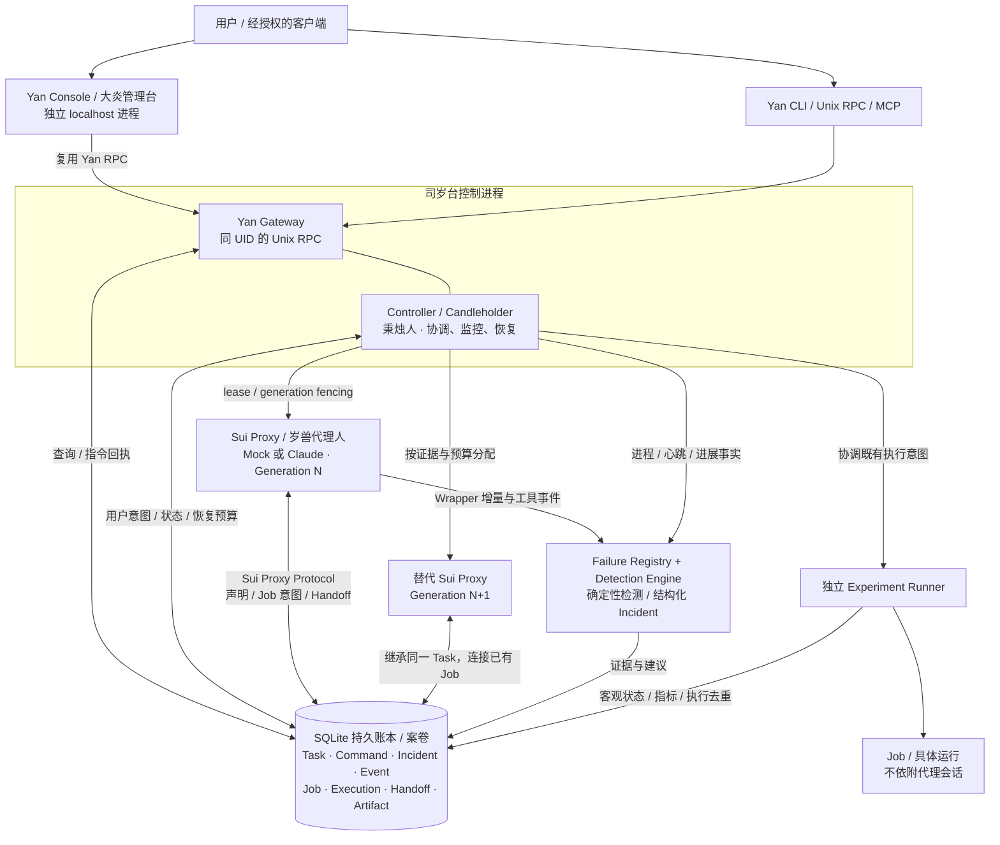

# 整体架构

当前版本：v0.4，包含独立 Yan Console、确定性故障检测与持久恢复。运行入口见 [项目概览](PROJECT_OVERVIEW.md)，实际验收见 [v0.4 交付报告](YAN_CONSOLE_DELIVERY.md) 与 [结构化进度](PROGRESS.json)。

控制主轴是 Python 3.11 标准库程序。SQLite WAL 是账本，Controller 周期性协调，Candleholder 负责确定性的 Sui Proxy 健康判断。两者不调用 LLM。Yan 提供 JSON CLI 和本地 Unix socket RPC；Sui Proxy 通过实际协议方法操作账本。任务的 desired、Sui Proxy 的 declared 和 Runner 的 observed 分开保存。

Controller 与 Candleholder 是同一独立控制进程中的协调与监控职责；Yan Gateway 在该进程提供本地 RPC。Console、各 Sui Proxy 与 Runner 独立运行。Sui Proxy 所有权在写事务内校验，Runner 在启动和取消副作用处再次核验授权；结果不明的执行保留 UNKNOWN，不据超时盲目重发。

## 模块和边界

- `store.py`：事务、显式迁移、备份、事件；每个操作独立连接，写入用 BEGIN IMMEDIATE，busy timeout + FULL synchronous。
- `service.py`：Task / Command 状态机、查询、幂等命令、Sui Proxy 注册领取、lease 与 fencing、语义报告、Handoff、Job 请求。
- `runner.py` / `job_process.py`：稳定 Job ID、幂等启动、执行端授权复核、独立进程、客观指标与结果。首轮只执行合成训练，不暴露任意 shell。
- `adapters.py` / `proxy_process.py`：可替换 SuiProxyAdapter；自动采集进程、流/工具活动、会话退出；Mock 与 Claude Code 共用生命周期。
- `registry.py`：独立私有 Sui Proxy 进程登记与心跳，为数据库锁住时的清理提供身份核验；不授予 lease。
- `failures/`：与进程登记不同的版本化故障库、固定检测算法、Claude 事件解码、Incident 持久化/恢复和离线重放；详见 FAILURE_ARCHITECTURE.md。
- `controller.py`：单实例 flock；先协调 Job，再检查 Sui Proxy，回收后增 generation，新 Sui Proxy 从账本取上下文。
- `console.py` / `static/`：独立 localhost Web 进程和原生前端，复用 Yan RPC；快照缓存、离线提示与人工指令回执，不直接打开 SQLite 或管理进程。
- `gateway.py` / `cli.py` / `mcp.py`：共享领域服务；Unix socket 基于文件权限和 Linux SO_PEERCRED 授权；MCP stdio 从受管启动环境取得 Sui Proxy 凭据。

## 副作用与崩溃窗口

1. 幂等命令以 actor + idempotency key 唯一，参数摘要冲突必须报错。
2. Job 启动意图先落库；task + logical job key 唯一，不包含 Sui Proxy generation。新 Sui Proxy attach 已有 Job。
3. 独立 Runner 获取 Job 文件锁，在数据库写事务内再次验证 task desired、generation、lease 和 Sui Proxy。记录 execution 后才执行合成工作。
4. 启动回执丢失进入 UNKNOWN；先按 Job ID 查账本和进程身份，禁止据超时盲目重发。持久 execution 记录避免重复执行。
5. 已经获准开始的 Job 不依赖 Sui Proxy lease 续期，Sui Proxy 被 SIGKILL 或轮换不会停止 Job。
6. 进程身份使用 boot ID + PID + /proc start ticks；未知或身份不符的进程只报告，绝不按名称扫杀。终止受管进程优先使用 pidfd；不可用时保守处理。

不能宣称任意远程 shell 的 exactly-once。首轮的去重保证针对本地受管 Mock Runner；跨网络 Adapter 必须提供稳定远端 operation ID 和查询能力。任意 shell、同 UID 文件访问和真实集群隔离是明确边界。

## 人工意图优先

HOLD/CANCEL 落库后撤销 Sui Proxy 所有权，自动协调不能恢复。HOLD 保留正在运行的 Job；CANCEL 默认也保留运行 Job；显式 cancel_job 只针对本地合成 Job，Runner 二次核验取消授权。真实实验终止尚未开放。取消任务不会隐含杀训练。终态 CANCELLED 不允许普通 resume 复活。

## 恢复路径

Sui Proxy 异常 → 审计原因 → 原子撤销 lease → 只终止身份核验通过的受管 Sui Proxy → 检查持久预算/冷却 → 创建新 generation → 从 Task、Command、Event、Handoff、Job、Artifact 获取上下文。Runner 的 UNKNOWN 不自动重新启动。Controller 重启重新查询持久关系，而不重建整个实验。

最大 Session 年龄默认 1800 秒，仅为可配置试验参数。轮换先请求 Handoff，等待有限 grace；即使旧 Sui Proxy 无法响应也能靠账本接管。轮换只影响 Sui Proxy。恢复次数、窗口、冷却和隔离状态跨 Controller 重启持久存在。

当前角色名为 Sui Proxy（岁兽代理人）；兼容字段和历史事件见 [命名约定](NAMING.md)。Console 的运行、截图与操作语义见 [Yan Console 使用指南](YAN_CONSOLE.md)。
