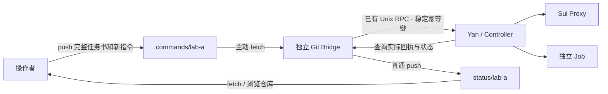

# Git 实例部署与操作

Git Bridge 已实现：操作者向私有 `sui-instances` 仓库 push 完整任务书或追加指令；服务器上的独立进程主动 fetch，通过现有 Yan Unix RPC 投递，再 push 实际回执和有时间戳的状态。**Git 断网、Bridge 停止或状态 push 失败不会 Hold、终止或轮换任务。**

本指南的示例实例为 `lab-a`。每个运行实例使用独立分支和本地状态；`local` 已用于本仓库的 Mock 验收，不要让另一台服务器接管它。



## 1. 前置环境

先按 [部署指南](DEPLOYMENT.md) 安装当前框架 release、初始化并启动 Controller。模型配置仍由 Controller 服务的本地环境提供，Git Bridge 不设置模型，也不自动升级框架。正式 GLM 任务先完成 [Claude Code 适配验收](CLAUDE_ADAPTER.md)；Mock 流程不需要模型密钥。

服务器需要 Git、私有实例仓库的非交互读写权限，以及与 Controller 相同的 UID。使用现有 SSH key / credential helper；不要把密钥放进任务书、Git URL 或指令文件。无需开放入站端口。

以下示例使用部署指南的路径：

```bash
SUI_YAN="$HOME/sui-regulator/current/venv/bin/yan"
SUI_HOME="$HOME/.local/state/sui-regulator"
SUI_BRIDGE="$HOME/.local/state/sui-regulator/bridges/lab-a"
SUI_INSTANCES="$HOME/sui-instances"
SUI_INSTANCE_REMOTE=git@github.com:RabbitEG/sui-instances.git
"$SUI_YAN" --home "$SUI_HOME" rpc yan.get_console_snapshot --params '{"section":"overview","limit":1}'
git ls-remote "$SUI_INSTANCE_REMOTE" refs/heads/main
```

`yan instance --help` 不存在说明安装版本过旧；按部署指南建立新 release 后再继续。

## 2. 建立实例分支（每个新实例一次）

在操作端或服务器 clone 仓库，然后从 `main` 创建分支。不需要把源码放入实例仓库。

```bash
git clone "$SUI_INSTANCE_REMOTE" "$SUI_INSTANCES"
cd "$SUI_INSTANCES"
git switch main
git pull --ff-only origin main
"$SUI_YAN" instance init-mailbox --repo "$SUI_INSTANCES" \
  --instance lab-a --epoch lab-a-install-20261105
# 只创建本地分支；此时没有启动任何任务。
git show commands/lab-a:instance.json
git push origin commands/lab-a status/lab-a
```

`commands/lab-a` 保存追加指令，`status/lab-a` 保存服务器观测。`main` 只保存说明、模板和操作工具。不要合并两条实例分支，不要 force push。`enrollment_epoch` 表示这一次安装；新机器的独立部署应使用新实例名和代号。

## 3. 在服务器绑定并启动 Bridge

登记需要 Controller 可查询，并检查远端 `instance.json`。登记本身不投递命令。

```bash
"$SUI_YAN" --home "$SUI_HOME" instance enroll \
  --state "$SUI_BRIDGE" --remote "$SUI_INSTANCE_REMOTE" \
  --instance lab-a --epoch lab-a-install-20261105
# 首次完整同步；允许在尚无任务时执行。
"$SUI_YAN" instance once --state "$SUI_BRIDGE"
# 前台持续运行，Ctrl-C 只停止 Bridge。
"$SUI_YAN" instance serve --state "$SUI_BRIDGE"
```

默认每 30 秒轮询、每 5 分钟或指令/主要状态变化时发布；故障使用随机指数退避，最长 5 分钟。实际耗时还包括 Git 网络调用，每次调用最多 30 秒。可在 enroll 时指定 `--poll-seconds`、`--publish-seconds`。单条失败指令不阻塞其他 Task。

正式常驻可用独立 user unit；在框架源码目录执行：

```bash
mkdir -p "$HOME/.config/systemd/user"
cp deploy/systemd/user/sui-git-bridge@.service "$HOME/.config/systemd/user/"
systemctl --user daemon-reload
systemctl --user enable --now sui-git-bridge@lab-a.service
journalctl --user -u sui-git-bridge@lab-a.service -n 50 --no-pager
```

前台 Bridge 和 systemd 服务只能二选一。unit 使用上面约定的 release 和状态目录；自定义路径需通过 unit override 修改。SSH agent / 网络代理等环境可放在本地 `~/.config/sui-regulator/git-bridge.env`，不要放入 Git。退出登录后仍需运行的服务器按部署指南配置 user lingering。

`systemctl --user stop sui-git-bridge@lab-a` 只停止传输，Task 继续。Bridge 与 Controller 没有 `Requires` / `PartOf` 关系。

## 4. 起一个完整任务

在**操作端**的实例 clone 执行。任务书写明目标、允许的操作、工作目录、已有实验、等待/核验/debug/继续实验的要求，以及最终验收条件。参考实例仓库 `templates/task-brief.md` 和 [任务提示词指南](TASK_BRIEFS.md)。

```bash
cd "$SUI_INSTANCES"
git fetch origin
git switch --track origin/commands/lab-a  # 已有本地分支时用 git switch commands/lab-a
git pull --ff-only origin commands/lab-a
python3 tools/command.py submit week-01 --id start-week-01 \
  --title '一周实验、核验与调试' --brief /path/to/full-brief.md \
  --workspace /srv/projects/experiment-a
# 审阅这两个文件；workspace 是服务器上的路径。
git diff --no-index /dev/null commands/start-week-01/command.json
git add commands/start-week-01/
git commit -m 'Submit week-01 task'
git push origin commands/lab-a
```

`git diff --no-index` 有差异时退出码为 1，这是审阅结果。默认 `adapter=claude`、`permission_mode=trusted`、不设总代理运行时长上限；用 `--adapter mock` 可跑合成任务。完整任务书作为现有 `objective` 原文送入 Yan，保留到后续换代，不改成 watchdog 提示词。任务书上限 16,384 字符、单文件 64 KiB；超限拒绝并给出回执，不截断后执行。

完成判定沿用既有完成标记协议，由任务内模型完成核验并提交标记；Git 中的报告不会自动将 Task 标为完成。Bridge 不判定实验成败，不增加会话轮换规则。

## 5. 追加要求、暂停与恢复

```bash
python3 tools/command.py instruct week-01 --id revise-week-01 --after start-week-01 \
  --text '当前实验结束后核验新的对照组，保留运行编号，再继续 debug。'
# 长指令可用 --file /path/to/instruction.md 替代 --text。
git add commands/revise-week-01/
git commit -m 'Add verification requirement'
git push origin commands/lab-a

python3 tools/command.py hold week-01 --id hold-week-01 --after revise-week-01
# 审阅并提交 push 后，暂停只在服务器收到并应用时生效。
```

`resume week-01 --after hold-week-01` 恢复，`cancel week-01` 不可恢复，`policy week-01 --permission-mode trusted` 调整已有权限模式。每次都审阅新增目录并 commit / push。明确执行 hold/cancel 工具会写入 `confirm` 字段，不会要求服务器再等在线审批。

同一 Task 的先后操作用 `--after COMMAND_ID` 明确排序；不要依赖文件名或提交时间。依赖只要求前一条 Yan 命令成功入账，不意味着前一条自然语言要求已经完成。互相依赖或不存在的依赖会保持 WAITING_DEPENDENCY；追加正确的新命令解决，原错误命令保留审计。

**已提交的指令目录不可改写。** 要改变要求就追加新 instruct；删除文件不撤销效果。Bridge 每轮读取当前分支快照，所以不要在 Bridge 读取前删除尚未送达的指令。修改已接收正文产生冲突回执；它不会执行被改写的新内容。

已有任务可在服务器做一次绑定，无需重建 Task。先停止该实例 Bridge，再执行并启动它：

```bash
"$SUI_YAN" instance bind-task --state "$SUI_BRIDGE" existing-experiment task-REAL-ID
```

此后用 `instruct existing-experiment ...`；不要为这个 task-key 再执行 submit。

## 6. 接收回执、状态和选定报告

```bash
git fetch origin
git show origin/status/lab-a:summary.md
git show origin/status/lab-a:receipts/start-week-01.json
git show origin/status/lab-a:tasks/week-01/status.json
git show origin/status/lab-a:snapshot.json
```

| 字段 | 含义 |
| --- | --- |
| `transport_state` | RECEIVED / WAITING_* / SUBMITTED / ACKNOWLEDGED / REJECTED，Bridge 传输状态 |
| `yan_command_id`, `task_id` | 实际后端实体，不是 Bridge 生成的成功声明 |
| `yan_status`, `yan_error` | 后端命令应用结果；ACKNOWLEDGED 仍可能对应 Yan REJECTED |
| `delivery`, `execution` | 指令投递和代理已读信息；不能把已读当作执行完成 |
| `desired`, `declared`, `status` | 用户期望、代理自述、框架观察，保留区别 |
| `completion` | Yan 已接受的任务完成记录 |
| `as_of`, `observed_at`, `query_stale` | 快照生成时间、实际查询时间、查询是否失效 |

Git 页面永远是带时间戳的快照。Controller 离线时保留最后观测并标记 UNREACHABLE / query_stale；Bridge 自身离线时旧 Git 页面不会自动变化，须检查时间。默认不回传完整对话、任务书、工具输出、数据库或环境配置。

需要回传模型写出的短报告，可在 **enroll** 时添加：

```bash
--report-root /srv/projects/experiment-a --report week-01=reports/weekly.md
```

已有配置可停止 Bridge 后修改本地 `config.json` 的 `report_root` / `reports` 再启动。报告必须是目录内显式指定的普通 UTF-8 文件，每份最多 64 KiB；拒绝符号链接、特殊文件和超限报告。常见密钥会过滤，但这不是完整的数据脱敏系统，选定报告本身仍应适合进入该私有仓库。导出失败记录在 `report-errors.json`，不会停止任务。移除导出配置会移除下一次状态快照中的报告，Git 历史仍保留旧版本。

## 7. 重启、故障与迁移边界

保留本地 `config.json`、`bridge.sqlite`（及 WAL）、`cache.git`。重启使用相同 state 运行 serve；**不要每次重新 enroll**。SQLite 收件记录先持久化准确请求，然后用稳定 Yan 幂等键投递；回执丢失后重新查询原命令，不重新创建任务。每个实例上限 10,000 条指令，每轮最多轮转处理 100 条；适用于低频任务干预，不是高吞吐队列。

| 情况 | 处理 |
| --- | --- |
| Git fetch / push 失败 | Bridge 退避；本地任务继续。检查服务日志和最后快照时间 |
| 分支被回退/重写 | COMMAND_HISTORY_REWRITTEN；修复为包含最后已接收提交的历史，不重置 Bridge 数据库 |
| 指令原文改写 | 保留原回执并记录 content_conflict；追加新命令 |
| Controller 离线 | 原请求保留等待，旧状态标记过期；恢复原 Controller 后继续 |
| LEDGER_CHANGED | 拒绝向不匹配的账本投递；不影响新账本中的本地任务 |
| 登记失败 | 尚未投递任何命令；检查错误后，仅删除本次失败登记新建的 state 目录再重试 |
| 状态 push 冲突 | fetch 新头后重建普通提交；保留未知文件，不 force push |

绑定身份包含 Yan home、数据库设备号和 inode；复制/恢复数据库到新 inode 也会改变身份。首版不提供自动跨机迁移、自动重新绑定或多主抢占。**不要复制旧 config 后手改 workspace_id 来重放旧仓库。** 新独立部署使用新实例分支和代号；需要保留既有任务时先完成 Controller 状态恢复，核对真实 Task 后在新实例用 bind-task 连接。原部署必须先停止，Git 分支不能隔离一台离线旧服务器。

本地 `inspect` 获取持锁状态，因此服务运行时请看 journal / 远端快照；停止 Bridge 后可执行 `yan instance inspect --state ...` 查看本地最后错误和回执。

## 8. 验证范围

`PYTHONPATH=src .venv/bin/python -m unittest tests.test_git_bridge -v` 覆盖真实本地 Git 仓库、Unix RPC、SQLite 和合成子进程：完整任务书、依赖、追加指令、Hold/Resume、原任务绑定、RPC 丢回执、重启去重、publish 失败、Git 冲突/回退/删除、换账本、离线陈旧状态、报告过滤/特殊文件、Mock 完成且仅一次 Job 执行。

这验证传输与控制链路，不代表 GLM 科研质量或一周运行已经实测。框架持续执行与模型适配仍需目标服务器验收。设计来源与未来边界见 [原设计文档](GIT_INSTANCE_DESIGN.md)。
