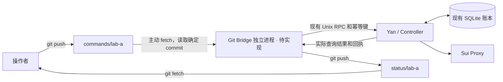

# 通过 Git 传递实例任务与回执：设计草案

**状态：仅设计，未实现、未启用。** 当前程序不会监听 Git 分支或执行本文的指令文件。本轮没有创建实例仓库、Git Bridge、定时拉取服务或远程控制端口。

目标是在只能稳定使用 Git 的情况下，让部署者提交新任务、补充要求、暂停或恢复任务，并取回有时间戳的状态、回执和报告。服务器主动拉取；断网期间现有任务继续运行。

## 1. 仓库与分支

建议建立独立的**私有实例仓库**，例如 `sui-instances`。不要把实例状态放进司岁台代码仓库的运行分支。

| 仓库 | 保存内容 | 更新方式 |
| --- | --- | --- |
| `sui_regulator` | 框架源码、测试、文档 | 按部署指南固定 release；任务消息不更新正在运行的框架 |
| `sui-instances` | 指令、投递回执、状态快照、选定报告 | 下述分支协议 |
| 实验／应用项目仓库 | 业务代码、实验方案、适合版本化的成果 | 由代理按任务授权维护，可在报告中引用 commit |

实例仓库中，一个部署实例使用两条分支：

- `commands/lab-a`：操作者追加不可变指令。
- `status/lab-a`：该实例的 Bridge 写回执、快照和报告。

`lab-a` 是稳定的 `instance_id`，不等于主机名、Task ID 或 Session ID。多实例使用不同分支对。指令分支以操作者为写入方，状态分支以实例为写入方，减少普通双向 `git pull` 的合并冲突。Git 仓库权限由部署者现有账号／部署凭据管理；分支命名本身不构成权限隔离。

## 2. 组件边界



Bridge 只负责文件格式、目标实例、投递、去重、查询与发布，不解释实验结果，不替模型做计划，不直接改 Controller 数据库或杀进程。Controller 不依赖 Bridge 存活；Git 不可达不会触发 Hold、换代或任务失败。

这借鉴 GitOps 的版本记录、主动拉取和持续核对思想，但任务指令是有回执的一次性命令，不能把目录内容当作随时重建整套任务的期望状态。删除任务文件不等于取消任务。[OpenGitOps 原则](https://opengitops.dev/)

## 3. 指令格式

每条指令使用一个不可变目录，JSON 和完整任务书在同一 commit 中提交：

```text
commands/lab-a 分支
  instance.json
  commands/
    20261105-001-start/
      command.json
      brief.md
    20261106-001-instruct/
      command.json

status/lab-a 分支
  snapshot.json
  summary.md
  receipts/<command_id>.json
  tasks/<task_key>/status.json
  tasks/<task_key>/report.md
```

`instance.json` 只声明实例 ID、协议版本和登记代号，不包含秘密。Bridge 在服务器本地明确登记远端仓库、两条分支、`instance_id`、`enrollment_epoch`、工作目录和状态目录。仅修改 Git 文件不能把另一台服务器登记为该实例。

一个拟议的新任务信封：

```json
{
  "schema_version": 1,
  "instance_id": "lab-a",
  "enrollment_epoch": "lab-a-install-20261105",
  "command_id": "20261105-001-start",
  "task_key": "week-20261105",
  "depends_on": [],
  "kind": "submit_task",
  "brief_path": "brief.md",
  "payload": {
    "title": "一周实验、核验与调试",
    "adapter": "claude",
    "permission_mode": "trusted",
    "workspace": "/srv/projects/experiment-a",
    "max_proxy_seconds": 0
  }
}
```

Bridge 将该 commit 中 `brief.md` 的 UTF-8 原文作为现有 `payload.objective`；路径相对于指令目录。仅接受普通文件及目录内相对路径。初版沿用 Yan 的长度和消息大小上限，超限给出明确拒绝回执，不截短要求后继续执行。

`task_key` 是 Git 侧易读的稳定名称，创建回执将它映射到真正的 Task ID。同一名称不能被第二个创建命令悄悄重新绑定。Task 更换 Session 后映射不变。

追加指令示例：

```json
{
  "schema_version": 1,
  "instance_id": "lab-a",
  "enrollment_epoch": "lab-a-install-20261105",
  "command_id": "20261106-001-instruct",
  "task_key": "week-20261105",
  "depends_on": ["20261105-001-start"],
  "kind": "instruct_task",
  "payload": {
    "instruction": "当前实验结束后，先核验新的对照组结果，再决定下一轮；保留现有运行编号和产物。"
  }
}
```

初版只映射已有 `submit_task`、`instruct_task`、`request_analysis`、`hold_task`、`resume_task`、`cancel_task`、`set_recovery_policy`。Hold／Cancel 在命令文件中额外要求 `confirm` 与对应动作完全一致；作者提交这样的 commit 即为明确操作意图，无需服务器等在线确认。这只用于明确终止性动作，不给普通自主调试增加审批。

指令可以按 Task 设置 `depends_on`。创建回执未到时，后续指令等待该 Task 的映射，不另起任务；无关 Task 继续接收指令。文件名中的日期只便于阅读，不是日历调度器。暂停、取消等动作只在服务器实际收到并应用后生效。

## 4. 投递、重试与回执

建议每 30–60 秒拉取一次命令分支，失败时带随机退避，最长 5 分钟。默认任务状态每 5 分钟或关键变化时发布一次，命令应用结果优先发布。数值是初始工程建议，尚无运行实测。

接收流程必须可在任意一步崩溃后恢复：

1. `fetch` 后固定目标 commit SHA，从该 commit 读取完整文件；不混用两次 fetch 的任务书与 JSON。需要多个 ref 时使用 `git fetch --atomic`。读取文件不触发 checkout hooks 或执行仓库脚本。[Git fetch](https://git-scm.com/docs/git-fetch)
2. 将信封、任务书内容摘要、源 commit、规范化 Yan 请求写入本地 Bridge 收件记录，再开始投递。同一 `command_id` 再出现只检查内容是否一致；内容改变则返回冲突，要求追加新命令。
3. 使用现有 Yan RPC，幂等键固定为 `git:<instance_id>:<enrollment_epoch>:<command_id>`。actor 沿用 RPC 的 `uid:<uid>`，不新造客户端可指定的身份。同一请求的所有重试使用相同 UID、幂等键与完整参数。
4. Yan 接收后保存 Command ID 和 Task ID，再查询 `yan.get_command_status`，直到得到实际 SUCCEEDED／REJECTED。进程在接收后、存本地结果前崩溃，也用相同请求找回原回执，不生成新的幂等键。
5. 将结果放入本地发布队列，随后提交到状态分支。push 失败只重试发布，绝不重新执行命令。状态分支发生冲突时 fetch 最新头、重新生成提交；不用 force push 覆盖未知更新。

远端分支快照和本地处理游标要分别保存。不能只记录“最后看到的 commit”，否则在命令尚未落盘时崩溃会漏掉指令。本地引用更新可使用带预期旧 SHA 的 `git update-ref`；它只保护本地引用竞争，不提供跨主机执行锁。[Git update-ref](https://git-scm.com/docs/git-update-ref)

回执应包含：

| 字段 | 含义 |
| --- | --- |
| `command_id`、内容摘要、源 commit | 对应操作者提交的哪一条原文 |
| `instance_id`、`enrollment_epoch` | 哪个登记实例处理 |
| `task_key`、`task_id`、`yan_command_id` | Git 名称和真实后端实体映射 |
| `received_at`、`submitted_at`、`observed_at` | 各阶段真实记录时间 |
| `transport_state` | 已获取、依赖未满足、已送 Yan、待发布等传输事实 |
| `yan_status`、`result`、`error` | 后端原始应用结果，不能由 Bridge 猜测 |
| `delivery`、`execution` | 沿用现有指令投递／已读声明；执行是否完成保持真实未知范围 |

**push 成功、Bridge 收到、Yan 入账、代理声明已读、整个任务完成是五件不同的事。** `instruct_task` 的 SUCCEEDED 只能表示指令入账。完成只引用 Task 已接受的完成标记，报告中的“做完了”不能由 Bridge 自动升级为完成。

修改、删除或回退已经执行的指令文件都不撤销其效果。需要更改要求就追加 `instruct_task`；需要停止就追加明确的 Hold／Cancel。分支被 force push 回旧历史时应报告异常且保留本地已处理集合，不重放旧指令，不暂停当前任务。

## 5. 回传什么数据

默认发布 Task 摘要、Desired／Declared／Observed、当前 Generation、最近一次运行观察、等待原因、命令回执、Incident 摘要和明确选择的报告。快照必须标记 `as_of`、最后成功查询 Controller 的时间和最后成功抓取 Git 的时间。Git 上的状态是带时间戳的快照；旧快照不能称作“当前在线”。

报告是代理声明，运行状态来自现有 Yan 查询，两者保留来源。完整会话和工具输出不默认发布；需要时由部署者指定范围，沿用已有分页和截断标记。导出的报告只来自本地配置的报告目录和明确选定文件，不递归上传整个工作区。

不上传活动 SQLite／WAL、租约、MCP 凭据、模型密钥、私有环境文件或 SSH 私钥。模型权重、数据集和大日志保存到已有授权存储，Git 中仅记录位置、校验值和权限说明。导出前做密钥过滤，超限内容记录为未发布并注明原因；回执和停止指令的处理不被大文件队列堵住。

本地发布队列应有容量限制：优先保留指令回执与终态报告，可合并中间状态快照。Git 故障时在本地记录错误并退避，继续执行 Task。Bridge 没有理由通过 Hold 来等待 Git 恢复。

## 6. 实例初建、重启与迁移

第一次部署按 [部署指南](DEPLOYMENT.md) 安装框架和模型运行环境。将实例仓库克隆到单独目录，再通过未来 Bridge 的本地登记步骤绑定分支、UID、Yan socket 和 `enrollment_epoch`。登记命令尚未实现，这里不提供假装能执行的 `yan git-*` 命令。

同机重启保留 Bridge 的收件记录、幂等映射和发布队列。新的空机器克隆实例仓库，不自动复制正在运行的 Controller 状态或重放历次 submit。新的 `enrollment_epoch` 防止把旧安装的指令直接送到新安装；恢复已有实例需要保留一致的 Controller 账本及 Bridge 状态。

初版只支持同一实例一个活动 Bridge 和一个 Controller。切换服务器必须先停止并确认旧实例，再迁移状态和工作位置；不能假设 Git 分支能隔离离线旧服务器。跨服务器 fencing、热备抢占和资源迁移不在此方案中。

## 7. 拟议的日常操作

下面只展示 Git 文件工作流；**没有 Bridge 时，push 不会触发司岁台动作。** 仓库和分支需先由部署者建立并登记。

```bash
git clone git@github.com:YOUR_ACCOUNT/sui-instances.git
cd sui-instances
git switch commands/lab-a
git pull --ff-only origin commands/lab-a
mkdir -p commands/20261105-001-start
# 将上面的 command.json 和完整任务书 brief.md 保存到该目录。
git add commands/20261105-001-start/command.json commands/20261105-001-start/brief.md
git commit -m 'Submit week-long experiment task to lab-a'
git push origin commands/lab-a

# 收取实例状态，不切换指令工作目录：
git fetch origin status/lab-a
git show origin/status/lab-a:summary.md
git show origin/status/lab-a:receipts/20261105-001-start.json
```

在外使用手机或另一台电脑，只要能编辑文件并 push 到已登记的指令分支，就沿用相同流程。新要求另建一个目录和 command_id，不能覆盖之前的 command.json。用状态分支的回执确认是否送达；服务器断网时指令仍排队，不能把本地 commit 视作已执行。

## 8. 实现前验收清单

此表是未来实现的测试要求，当前未运行这些 Bridge 测试。

| 场景 | 必须验证的结果 |
| --- | --- |
| 同一文件多次 fetch／同一请求重发 | 同一 Yan Command、同一 Task，无重复创建 |
| RPC 已接收后 Bridge 崩溃 | 通过原幂等键找回回执 |
| 状态 push 失败一整天 | Task 继续；恢复后发布回执，不重复执行 |
| 新任务和后续指令在一次 fetch 到达 | 后续指令关联真实 Task，依赖之外的任务不被阻塞 |
| 同一 command_id 改正文 | 冲突回执，保留原执行结果 |
| 分支删除／回退／旧安装指令 | 不自动取消、不重放、不投递到错误安装 |
| Hold 后模型或重试恢复 | 用户停止意图保留，符合现有 Yan 语义 |
| Controller 暂时离线 | 显示最后查询时间；稍后复投原请求，不伪造成功 |
| 报告含秘密、超大文件、目录外引用 | 不发布敏感内容；保留准确的导出错误和命令回执 |
| Bridge 停机、不同状态分支有新 commit | Controller 独立运行；不 force push 覆盖未知提交 |

第一版的范围应止于“文件指令 → 现有 Yan → 可查询回执／选定报告”。不同时引入任意远程 Shell、框架自动升级、完整日志平台或多主调度。
