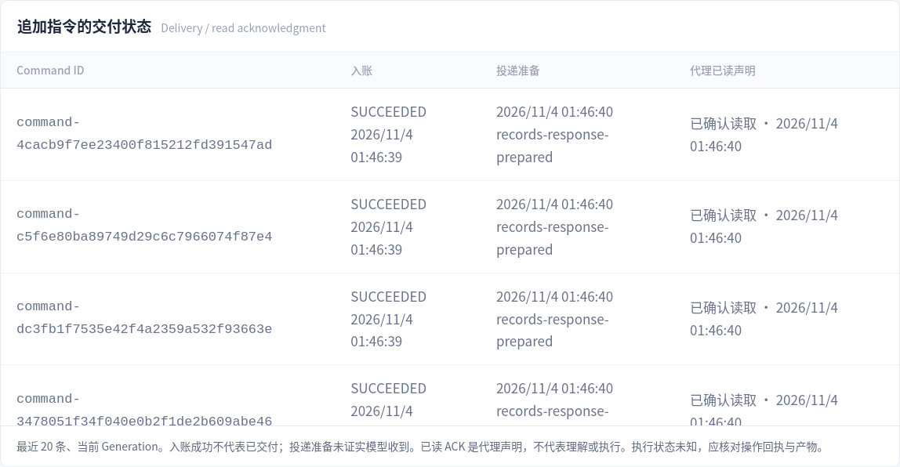
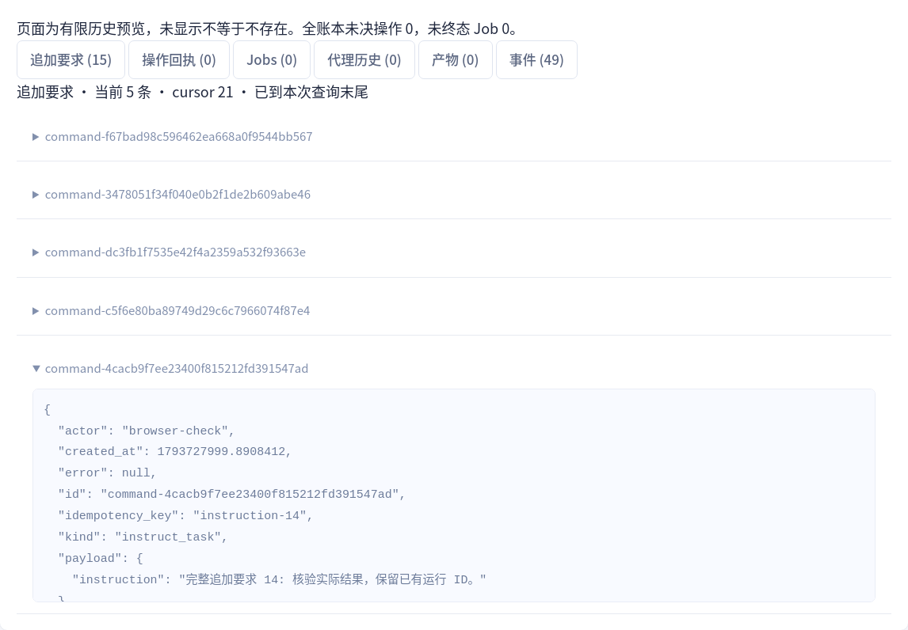
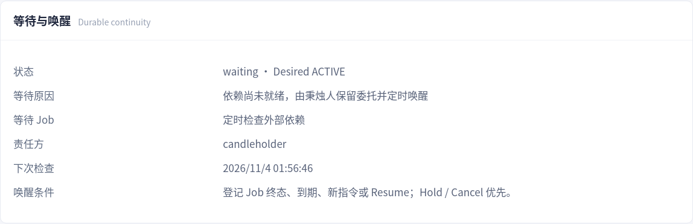

# 职责基线迭代：实现与验收

规范：[职责基线](RESPONSIBILITY_BASELINE.md)。本轮实际开始于 `30f0242ba4675d5261adf8cf0e744196543b7ae8`，2026-11-04 fetch 核对 origin/main，初始工作区干净。此报告描述本轮实现与本地证据；真实 GLM 和目标服务器仍待验收。

## 已完成的职责修正

用户定义要求，Sui Proxy 决定工作内容、debug 和语义完成；Candleholder 保持受管运行连续性。保留已有 Persistent、合作式换代、可选验证脚本、权限配置和独立 Job，不引入业务评分或资源迁移器。

| 部分 | 具体变化 | 关键源码 |
|---|---|---|
| 操作事实 | 后台 handle 为 RUNNING；失去观察、丢回执为 UNKNOWN；普通 stopped 为 STOPPED，worker_restart 保留未知原因。按 Session / tool_use_id / handle 关联，重复和乱序不倒退终态 | [attempts](../src/sui_regulator/attempts.py)、[Hook](../src/sui_regulator/tool_hook.py) |
| 诊断与去重 | UNKNOWN 期间仍可使用 Read / Glob / Grep 和部署者批准的只读模板。已知 RUNNING 可用明确批准的不冲突模板；任意 Shell 不做伪只读分类。run_command 的 operation_id 区分请求重送和有意新尝试，跨代重送返回原回执 | [commands](../src/sui_regulator/commands.py)、[Protocol](../src/sui_regulator/protocol.py) |
| 指令投递 | 初始输入、工具前后与 Stop Hook 提醒；两种 profile 均启用自有 Hook，工具授权不扩大。持久保存每代 offered 与明确已读 ACK，执行未知；长工具不被投递强制打断 | [requirements_delivery](../src/sui_regulator/requirements_delivery.py)、[Adapter](../src/sui_regulator/claude_adapter.py) |
| 完成协议 | 最新要求版本与本代 ACK 双重检查；投递准备不能替旧完成调用确认已读。已入队尚未应用的新要求、Hold / Cancel 优先；文件完成也检查 lease 仍有效 | [completion](../src/sui_regulator/completion.py) |
| 等待 | 代理主动登记原因、对象、责任方与检查时间，释放当前 Session。Controller 重启后仍等待；到期、登记 Job 终态、新指令或 Resume 接续同一 Task。Hold / Cancel 优先 | [waiting](../src/sui_regulator/waiting.py)、[Controller](../src/sui_regulator/controller.py) |
| 长上下文 | 完整原始任务书不改写；指令与历史有界分页，history_refs 可继续读取原文，未决数量取全账本。旧代理可精确查询，控制台可打开历史会话 | [records](../src/sui_regulator/records.py)、[Service](../src/sui_regulator/service.py) |
| 观察与 UI | “最近运行证据更新”不表示业务进展。新命令结果包括非零退出码，只作为配置范围内观察；Console 展示真实交付阶段、等待与完整历史索引 | [recovery](../src/sui_regulator/recovery.py)、[Console](../src/sui_regulator/static/console.js) |
| 兼容部署 | schema 5 → 6 → 7；旧 Task 权限和 UNKNOWN 保留。旧版本拒绝新 schema，匹配的升级前备份可恢复读取 | [迁移](../src/sui_regulator/store.py)、[部署指南](DEPLOYMENT.md) |

提示词版本为 `sui-proxy.prompt.v3`，结构、来源和字段见 [提示词设计](PROMPT_AND_LIFECYCLE_DESIGN.md)。原始用户要求、追加要求、真实观察和未核验代理笔记分开；固定协议不规定某个实验流程或成功标准。

## 完成与等待的明确边界

没有配置 verifier 的普通任务可以完成；配置了 verifier 则必须满足它。FAILED 实验可以回答用户问题，成功测试也不能替代理宣布整个任务完成。框架只接受代理的完成声明并校验协议；ACK 不证明理解或执行。

**保留运行中的受管服务并移交责任后结束 Task，当前不支持。** 没有可靠的责任转移契约，因此继续要求受管 Job 已知终态、命令副作用已明确；保持 Task 工作或按支持的 wait_task 契约等待。外部资源只可定时再检查，没有资源订阅或迁移。原生后台工作仍依赖当前 CLI 时不能主动交出该运行时。

追加要求通过工具往返或 Stop 边界进入下一次模型请求，不能保证正在运行的工具中途读取它。Hook 返回与 stdin 写入只记录“投递准备”；明确 ACK 是代理声明，执行阶段始终不虚构。[Claude Hook 行为](https://code.claude.com/docs/en/hooks)

## 要求到测试的映射

下表均为本地已通过场景；“实际 CLI”指 **Claude Code 2.1.316 + loopback FakeAnthropic**，不是实际 GLM 决策。详细函数名、结果和数量见 [完整原始输出](responsibility-test-output.txt)。

| 验收 | 代表性回归与实际证据 |
|---|---|
| A01 大量普通失败 | [PersistentRecoveryTests](../tests/test_persistent_recovery.py) 的 repeated_experiment_failures：30 次失败不隔离，错误和代码变化不作为业务进展；[实际 CLI](../tests/test_claude.py) native_hook_leaves_experiment_retries_to_model 验证后续 Bash 仍执行 |
| A02 同错误复测 | 同上重复失败回归；[OperationBoundaryTests](../tests/test_operation_boundaries.py) operation_id_distinguishes_redelivery_from_intentional_retry：原请求重送一次副作用，新尝试另一次副作用，换代和丢结果不能绕过 |
| A03 缺少运行证据 | PersistentRecoveryTests changed_self_reports_do_not_reset_no_progress_timer；普通声明不刷新运行证据，提醒不产生强制轮换 |
| A04 临时基础设施失败 | PersistentRecoveryTests default_task_survives_thirty_proxy_start_failures / rule_retry_window_defers_without_ending_task；[ClaudeContractTests](../tests/test_claude.py) partial_stream 与本地流式故障接续 |
| A05 慢 Session | [CompletionContractTests](../tests/test_completion_contract.py) old_healthy_session_can_continue_slow_debugging_past_grace；实际 CLI native_cli_verifies_edits_and_runs_followup_experiment 在极短年龄阈值下同一代等待、失败、编辑、复测 |
| A06 自然退出/回合上限 | PersistentRecoveryTests normal_turn_budget_rotates_without_counting_a_fault；ClaudeContractTests cli_adapter_mcp_job_wait_and_fresh_session_completion |
| A07 Controller 重启 | [FaultTests](../tests/test_faults.py) T07_real_controller_sigkill_preserves_worker_and_job_on_restart；[TaskContinuityTests](../tests/test_task_continuity.py) wait_survives_controller_restart_and_new_instruction_wakes_same_task |
| A08 已知后台工作 | OperationBoundaryTests background_handle_is_running_and_terminal_notification_is_idempotent / operator_approved_independent_work_runs_alongside_known_background_only；实际 CLI 后台失败后同 Session 执行后续动作 |
| A09 回执丢失 | FaultTests T13_actual_spawn_then_lost_ack_reconciles_without_replay；OperationBoundaryTests unknown_still_allows_actual_approved_diagnostics / unknown_command_cannot_be_bypassed_with_a_new_job_key / operation_id 跨代检查 |
| A10 证据不足 | FaultTests ambiguous_dispatch_without_process_is_unknown_and_not_retried；PersistentRecoveryTests unresolved_command_requires_operator_verification_on_hold；未知不伪造终态或无副作用 |
| A11 通知协议 | OperationBoundaryTests normal_stop_is_separate_and_restart_does_not_claim_known_exit / terminal_before_hook_wrong_handle_and_old_owner；普通 stopped / worker_restart 为协议回放，真实 CLI 只覆盖完成/失败通知 |
| A12 失败后继续 | TaskContinuityTests same_failed_experiment_can_continue_or_complete_only_by_proxy_decision：同一实验失败，代理选择继续，Task ACTIVE |
| A13 失败后完成 | 同一测试的另一个代理决定：FAILED 实验已回答任务，允许提交完成 |
| A14 成功但未完成 | 同一测试的反向场景：Job COMPLETED，代理继续分析，Task 不自动结束 |
| A15 可选 verifier | CompletionContractTests native_manifest_is_consumed_and_failed_experiment_is_not_session_failure / full_unicode_evidence_survives_manifest_write_and_acceptance |
| A16 必需 verifier | [TaskBriefTests](../tests/test_task_brief.py) failed_verification_requires_debugging_before_completion：失败拒绝本次完成，成功后可再提交 |
| A17 指令与完成竞态 | TaskContinuityTests tool_completion_cannot_silently_refresh_unread_requirements / queued_user_controls_and_requirements_precede_completion_acceptance；CompletionContractTests old_requirement_revision_does_not_complete_new_instructions |
| A18 用户控制优先 | TaskContinuityTests durable_wait_does_not_spawn_and_hold_wins_wakeup / queued_user_controls_and_requirements_precede_completion_acceptance；[LifecycleTests](../tests/test_lifecycle.py) cancel_prevents_recovery_and_retains_running_job |
| A19 代际与权限 | TaskContinuityTests ack_is_idempotent_and_retired_generation_cannot_ack / file_completion_cannot_bypass_an_expired_lease_before_health_tick / history_lookup_is_task_scoped_and_old_proxy_keeps_identity_view；FaultTests competing_claims / expired_lease；现有 Gateway/MCP 角色与路径限制回归 |
| A20 诚实 UI/API | 实际 CLI live_instruction_reaches_same_cli_session_and_requires_explicit_read_ack（两个 profile）；[新浏览器验收](../scripts/verify_responsibility_browser.py)；原 Console 离线、回执、暂停刷新与独立进程浏览器回归 |
| A21 长上下文 | TaskContinuityTests long_instruction_history_has_lossless_pages_and_cannot_be_silently_skipped：30 条长要求、逐页原文一致、未读不能完成；浏览器真实 RPC 读取两页完整指令 |
| A22 升级与协作 | OperationBoundaryTests schema5_migration_preserves_unknown_and_permissions：v5 数据升级、权限不变、未来版本拒绝、升级前一致备份恢复读取；CoreTests backup；非 editable wheel 演示；fetch 确认远端、不 force push、不重写历史 |

另外验证等待定时器 / 登记 Job 终态唤醒、原 Job 不重启，以及重复 ACK 不产生重复审计事件。

## 测试证据与复现

最终完整套件 **157 项通过、0 skip**，其中 8 项已安装 CLI 测试（新指令用例含两个 profile）；四组浏览器合计 **45 项检查通过**。非 editable wheel 安装后独立 Console、schema 7 和故障换代演示通过：同一 Task、同一 Runner PID、一次 execution。新 UI 还验证了 50 代预览之外的旧 Session 精确打开。

- [操作边界修复前](responsibility-operations-red.txt) / [阶段二通过输出](responsibility-operations-tests.txt)。
- [接续修复前](responsibility-continuity-red.txt)、[过期 lease 修复前](responsibility-completion-lease-red.txt)、[入队控制竞态修复前](responsibility-queued-controls-red.txt)。
- [完整测试输出](responsibility-test-output.txt)、[结构化汇总](responsibility-verification.json)。
- [新 Console 验收](responsibility-browser-report.json)、[原 Console 回归](responsibility-console-regression.json)、[会话阅读器回归](responsibility-reader-regression.json)、[任务书回归](task-brief-browser-report.json)。

```bash
PYTHONPATH=src SUI_TEST_REAL_CLAUDE=1 .venv/bin/python -m unittest discover -s tests -v
PYTHONPATH=src .venv/bin/python scripts/export_schemas.py --check
.venv/bin/ruff check src tests scripts
PYTHONPATH=src .venv/bin/python scripts/verify_responsibility_browser.py
```

实际 CLI 需要安装 2.1.316+；没有 CLI 时测试明确 skip。浏览器脚本需要 Playwright 和 Chromium，可通过 --browser 指定。所有测试使用私有临时目录、本地假 API 或合成 Runner。首轮完整验收遇到临时目录清理竞态，原因是 CLI 退出后的短暂 Hook 收尾；测试清理现在仅对 ENOTEMPTY 限时重试，不忽略其他错误，最终输出重新保存。

## 界面

以下是实际 Chromium / HTTP / Yan RPC / SQLite 的合成演示截图，不是设计稿；已读声明来自 Mock Proxy 调用真实协议。







## 部署与提交

启动命令、SSH 转发、固定 release 安装、一致备份及 schema 7 升级见 [部署指南](DEPLOYMENT.md)。本地演示：`PYTHONPATH=src .venv/bin/python -m sui_regulator console-demo --port 8766`。它自动启动独立本地 Controller 和 Console，只操作自己的临时演示数据；不用于正式部署。

已推送阶段：`88d2e20`（基线与映射）、`4150607`（后台状态与诊断）。接续实现、Console、迁移与完整验收：`ffee13d`；证据汇总绑定该完整 SHA。新增提交 Author 为 **GPT-6 Astra**，Committer 为 **RabbitEG**；不改旧作者、不重写历史、不 force push。最终 push 前再次 fetch 与核对 origin/main。

## 尚未验收或不提供

真实 GLM 的工具理解、长时间遵循任务书、企业网络、实际远端提交/查询/停止、生产 systemd/cgroup、真实资源迁移和 GPU/NPU 实验尚未验收。普通 stopped / worker_restart 没有实际平台停止演练，也没有为此新增 TaskStop 权限。明确 read_only / allow_during_background 模板依赖部署者批准，不提供任意 Shell 的自动副作用证明。无法观察的外部工作仍要由代理或操作员核验。UI 的 ACK 不表示工作已完成，运行证据也不等于科学结论。
