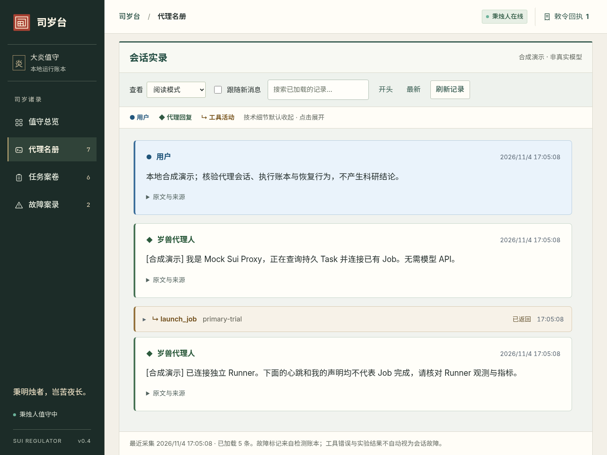

# Yan Console 阅读体验更新

实现版本：`2d98d62`，2026-11-04。此前的官署配色和案卷分区保留，重点调整字体、语言、正文阅读和消息来源识别。控制台展示已有记录，不复刻原生 CC，也不额外推算思考或工具耗时。

后续更新：2026-11-05 起，会话改为最近 100 条预览、点击单条详情按需读取全文。本文的 400 条保存分段和自动展开交互描述属于历史版本；当前行为与验收见 [会话窗口更新](verification/transcript-window/README.md)。

## 使用变化

| 需要做什么 | 当前行为 |
|---|---|
| 看清标题与正文 | 正文默认 18px、对话约 19px，标题加粗并使用深绿色；仍有 20px / 22px 阅读模式 |
| 统一字体 | 中文为思源黑体，英文为 Inter，代码为 JetBrains Mono；没有宋体。三个字体文件均由本地 Console 提供 |
| 切换语言 | 顶部选择中文或 English；界面每次显示一种语言。任务、对话与证据保留原文，草稿和阅读状态保留 |
| 阅读任务书与回复 | 支持 Markdown 标题、列表、粗体、引用、表格、链接和代码块；可展开原文与复制代码 |
| 区分谁在说话 | 用户蓝色、代理浅纸色、工具浅棕色、运行时灰蓝色；同时有文字与符号标识，不只依赖颜色 |
| 减少技术噪声 | 运行协议和工具参数/返回默认折叠；有相同 `call_id` 的调用和返回合并，无编号时不猜测配对 |
| 找到会话中的故障 | 使用该代际已有 Incident 标记检测位置；GEN-001 标明检测窗口，可进入证据、最终动作和恢复结果 |
| 手机阅读 | 查找与定位放入可展开的“阅读选项”；宽表格与代码在内部滚动，正文随字号放大 |

阅读器没有新增 thinking 采集、时长估算或实验成败判断。工具返回错误只表示工具返回错误，是否调试、继续实验或完成任务由代理负责。标记的检测窗口来自已有检测证据，并不等于窗口内每句话都已被证明有问题。

初始用户要求从实际注入内容中的 operator 字段单独记录；长目标和验收条件分段保存并在页面合并，避免整段运行协议 JSON 被截断后掩盖用户的完整要求。实际发给模型的提示词和核心状态机没有改变。新采集形式只适用于更新后启动的代理，不能修复已经丢失的历史内容。

## 界面截图

下面均由真实本地 Console、Controller、RPC 和 SQLite 驱动。对话和实验场景是明确标注的合成验收材料，不是 GLM 输出。



总览截图已在移除游戏素材后重新拍摄；本页其余截图与测试数据保留阅读器阶段记录。

[中文总览](screenshots/yan-console/overview-zh.png) · [英文总览](screenshots/yan-console/overview-en.png) · [英文会话界面](screenshots/yan-reader/conversation-roles-en.png) · [Markdown 任务书](screenshots/yan-reader/task-markdown-zh.png) · [Markdown 会话](screenshots/yan-reader/conversation-zh.png) · [GEN-001 检测位置](screenshots/yan-reader/incident-in-conversation.png) · [手机阅读](screenshots/yan-reader/conversation-mobile.png)

## 运行与演示

源码目录中的无模型演示：

```bash
PYTHONPATH=src python3.11 -m sui_regulator console-demo --port 8765
```

打开 http://127.0.0.1:8765。进入“跨代际连续性验证”，从代际历史打开第一代代理，点击“下一处故障”，查看 GEN-001 的检测证据、最终动作与原有 Job。第二代沿用同一任务和作业，执行次数仍为一次。

真实状态目录分别启动 Controller 和 Console：

```bash
PYTHONPATH=src python3.11 -m sui_regulator --home .sui serve
# 另一终端
PYTHONPATH=src python3.11 -m sui_regulator --home .sui console --port 8765
```

首次使用先运行 `--home .sui init`。正式服务器部署按 [部署指南](DEPLOYMENT.md#当前阅读体验版本的升级) 安装独立 release；不能用源码 `git pull` 代替更新非 editable 安装。任务书模板、权限与实验闭环要求见 [任务书指南](TASK_BRIEFS.md)。

本轮没有新 RPC 方法或数据库迁移。已有 `yan.get_incidents` 增加可选 `proxy_id`，服务端核验它属于指定 Task；旧客户端省略参数继续正常工作。Controller 和 Console 应更新到同一 release。界面更新本身不要求轮换仍在工作的代理。

## 验收证据

| 验证 | 结果 |
|---|---|
| Python 全套（启用已安装 CLI 本地合约测试） | **159 通过，0 跳过**；Claude Code 2.1.316，使用本地假 API |
| 浏览器行为检查 | **72 项通过**，包括已有控制回执、离线/冻结/UNKNOWN、任务书、职责接续和新版阅读检查 |
| 响应式布局 | 原有分区检查 132 例；新增双语与 Markdown 检查 144 例；合计 **276 例** |
| 字体 | Chromium 实际使用 Inter、思源黑体和 JetBrains Mono，均为本地自定义字体 |
| 安全渲染 | 原始 HTML 按文字显示；危险链接不生成；远程图片不自动请求；无页面脚本错误或外部资源请求 |
| 安装包 | 非 editable wheel 的 **13 个静态路由**与源码字节相同，许可证齐全，ETag 重验证与 CSP 通过 |
| 控制边界 | Hold 仍要求确认；真实回执可查询；工具错误不升级为会话故障；页面不直接杀进程 |

汇总与源码指纹：[summary.json](verification/yan-reader/summary.json)。详细报告：[阅读与双语](verification/yan-reader/reading.json)、[布局与键盘](verification/yan-reader/layout.json)、[控制操作](verification/yan-reader/controls.json)、[会话记录](verification/yan-reader/session.json)、[任务书](verification/yan-reader/task-brief.json)、[职责接续](verification/yan-reader/responsibility.json)、[wheel](verification/yan-reader/wheel.json)、[Python 原始输出](verification/yan-reader/python-tests.txt)。

复现命令：

```bash
SUI_TEST_REAL_CLAUDE=1 PYTHONPATH=src .venv/bin/python -m unittest discover -s tests -q
.venv/bin/python scripts/export_schemas.py --check
.venv/bin/ruff check src tests scripts
.venv/bin/python scripts/verify_console_reading.py --browser /usr/bin/chromium-browser
```

另外五个浏览器脚本为 `verify_console_browser.py`、`verify_session_reader.py`、`verify_task_brief_browser.py`、`verify_responsibility_browser.py`、`verify_console_design.py`，均接受 `--output` 与 `--report`。Playwright 只用于开发验收，运行 Console 不需要它。

## 数据与资源边界

界面语言只作用于应用文案；存储内容、标识符和后端错误保留原文。静态字体与 JS 本地打包，字体首次加载约 8.2 MB；随后使用 ETag 重验证，账本响应保持 `no-store`。依赖固定为 markdown-it 15.0.3 与 DOMPurify 3.4.17，来源、哈希和许可见 [资源清单](console-reading-assets.json) 与 [第三方声明](../THIRD_PARTY_NOTICES.md)。

会话每代仍有 4 MiB 上限，单条 8000 字符；浏览器保留最近加载的 400 条记录。故障标记每次 20 条、最多保留最近加载的 100 条，分页未完成或历史释放都会提示。未采集、已截断或超出保存上限的内容不会根据其他事件补造。

真实 GLM、实际训练、服务器重启与目标机 systemd / cgroup 行为不在本地合成验收的证明范围内，仍按部署指南现场验证。
