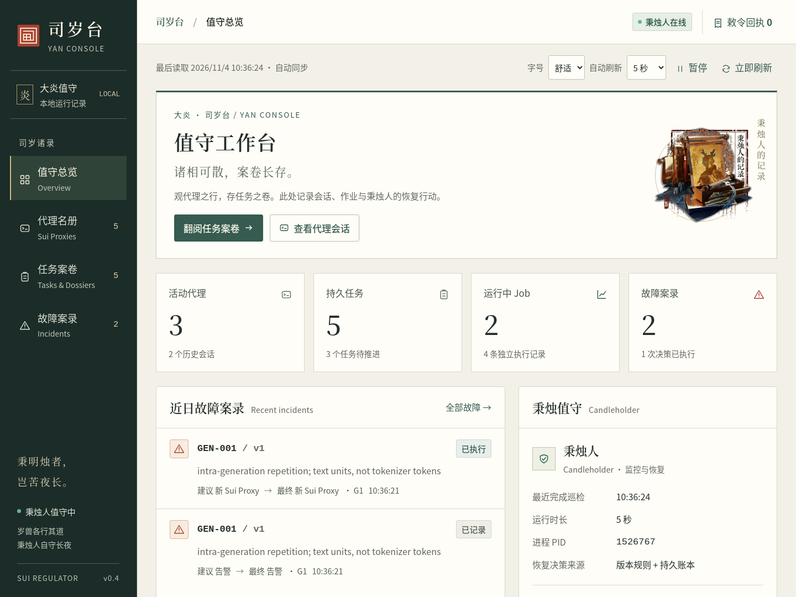
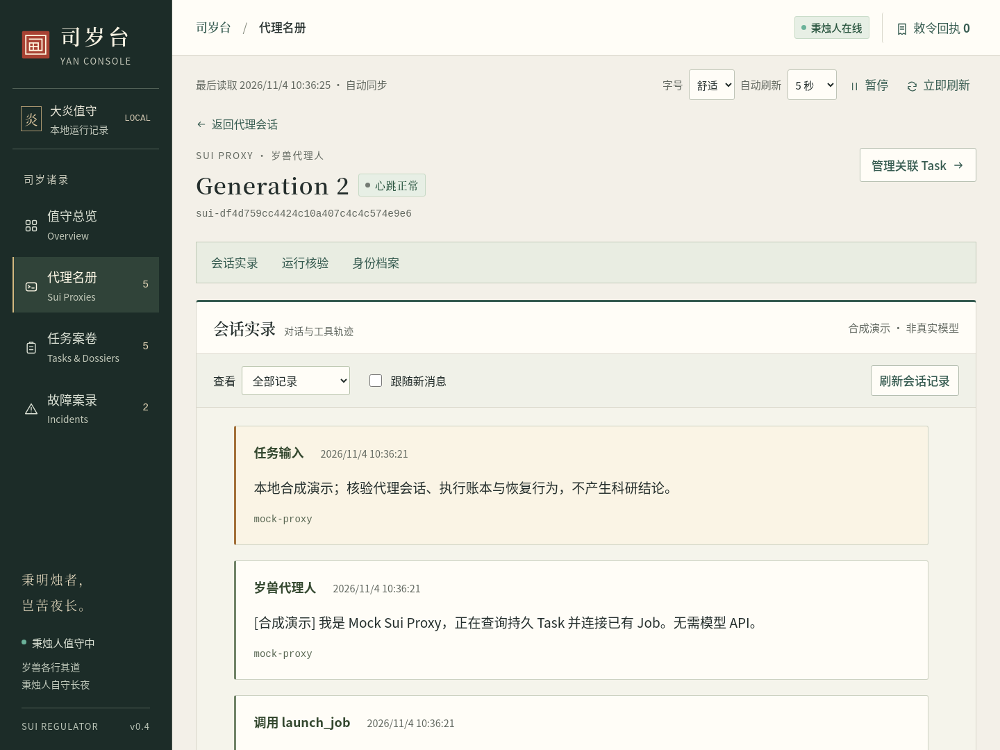

# Yan Console · 值守与案卷

[文档目录](README.md) · [运行与使用](YAN_CONSOLE.md) · [部署指南](DEPLOYMENT.md)

本次将控制台整理为司岁台的值守界面：墨绿导航、纸色案卷、朱印提示，标题承接 README 的叙述，正文保持清楚的操作含义。实现提交为 `5e0b74c`，基于 `672322e`；Author 为 **GPT-6 Astra**。

## 阅读与导航

| 调整 | 使用效果 |
|---|---|
| 文字与层级 | 正文 18px，对话约 19px；可选 20px / 22px 大字号。标题用宋体，正文用无衬线字体，ID 和工具内容用等宽字体。元数据使用深灰色，表格在自身区域滚动。 |
| 值守总览 | 先看全局计数、近日故障与秉烛人状态；最近事件进入有高度限制的阅读区。左乐模组卷册仅作小幅点缀，不放在运行数据背后。 |
| 任务案卷 | 用户意图、代理声明、Runner 观测仍分别展示。任务总览、执行核验、敕令回执、历史案卷各自成区，各分区共用顶部人工操作。 |
| 代理名册 | Task 顶部可直达当前代理。进入代理详情先读会话实录，再通过“运行核验”“身份档案”查看进程证据和代际历史。 |
| 持续阅读 | 刷新保留所选分区及其键盘焦点、展开的命令结果和阅读位置；修复跳转正文时意外离开当前路由的问题。 |
| 手机与键盘 | 小屏采用带文字的底部导航；任务分区支持方向键、Home / End；导航点击区域至少 44px。 |

“案卷”仍是 Task 关联记录的集合意象；“敕令”对应已有 Command，“秉烛人”对应 Candleholder。状态枚举、故障规则、数据库与恢复逻辑沿用既有实现，详见 [命名约定](NAMING.md)。新增服务端内容只有本地 PNG 静态路由，没有新 RPC、控制命令或数据迁移。

卷册沿用仓库已有的《明日方舟》左乐模组「秉烛人的记录」，完整来源、原始文件校验和与权利说明见 [素材记录](assets/arknights/README.md)。素材随安装包提供，页面不请求外部站点。项目自绘印章式 SVG 用作品牌标记；没有新增游戏设定。

## 实际界面

以下均为 Chromium 访问实际 localhost HTTP / Yan RPC / SQLite 生成的截图。Task、Proxy 和 Runner 场景为合成演示，没有真实模型调用。





| 场景 | 截图 |
|---|---|
| 完整任务书、三种状态与恢复配置 | [任务总览](screenshots/yan-redesign/task-summary.png) |
| Job、实际指标与工具执行回执 | [执行核验](screenshots/yan-redesign/task-execution.png) |
| 检测建议、最终动作与应用结果 | [GEN-001 故障详情](screenshots/yan-redesign/incident-detail.png) |
| 本浏览器的真实人工操作回执 | [敕令回执抽屉](screenshots/yan-redesign/command-receipts.png) |
| 投递准备、代理已读声明与完整历史 | [已读声明](screenshots/yan-redesign/instruction-ack.png) · [历史分页原文](screenshots/yan-redesign/instructions-history.png) |
| Controller 不可达 | [离线快照](screenshots/yan-redesign/controller-offline.png) |
| 手机阅读 | [值守总览](screenshots/yan-redesign/overview-mobile.png) · [特大字号会话](screenshots/yan-redesign/session-mobile-large.png) |

## 本轮验证

[验证汇总](verification/yan-redesign/summary.json) 记录实现 commit 和本轮范围。历史完整测试报告仍保留，此次验证专门覆盖界面和 Console 接口。

| 验证 | 结果与证据 |
|---|---|
| Console / 兼容接口 | **13 项通过**，[原始输出](verification/yan-redesign/unit-tests.txt) |
| 原 Console 操作回归 | **16 项通过**；Hold 明确确认、Resume、Instruct、真实 Receipt、原 Job/PID 与一次执行、暂停刷新、冻结、UNKNOWN、Controller 离线、刷新保留展开回执。[报告](verification/yan-redesign/console.json) |
| 会话阅读器 | **15 项通过**；真实采集、原文与工具返回、旧代际、筛选、增量分页、阅读位置、文本转义、离线快照。[报告](verification/yan-redesign/reader.json) |
| 完整任务书 | **7 项通过**；真实创建、原文持久化、恢复策略及 Hold 保留。[报告](verification/yan-redesign/brief.json) |
| 指令交付与接续 | **8 项通过**；两页完整历史、Mock 显式 ACK、等待责任、50 代之外的旧代理查询。[报告](verification/yan-redesign/responsibility.json) |
| 新版阅读与导航 | **10 项检查通过**，包含 **132 个布局组合**：360 / 390 / 1024 / 1440 宽度 × 三档字号 × 列表、详情和 Task 分区；页面、侧栏没有横向溢出，顶部没有垂直裁切。另测键盘导航、分区保留、快捷定位、默认字号及本地素材。[报告](verification/yan-redesign/design.json) |
| 颜色检查 | 对正文、元数据、状态标签、导航和操作等 20 类文字取样，最低对比度 **5.22:1**。这是取样检查，不等同于完整无障碍认证。[原始比值](verification/yan-redesign/design.json) |
| 安装包 | 非 editable wheel 安装后，6 条静态路由全部 HTTP 200；PNG 与原文件 SHA-256 一致，版权说明随包提供；无 Controller 时显示不可达且不创建账本。[报告](verification/yan-redesign/wheel.json) |
| 静态检查 | `ruff check src tests scripts` 与 `git diff --check` 通过。 |

浏览器共 **56 项检查通过**，无页面脚本错误、无外部页面请求。浏览器为 Chromium 133.0.6943.141；没有复测真实 GLM、目标服务器 systemd 或真实实验质量，应用控制边界仍以 [职责基线](RESPONSIBILITY_BASELINE.md) 为准。

复现需要已有开发虚拟环境中的 Playwright 与 Chromium，运行 Console 本身无需这些依赖：

```bash
PYTHONPATH=src .venv/bin/python -m unittest tests.test_console tests.test_proxy_compat -v
.venv/bin/ruff check src tests scripts
YAN_QA_OUTPUT=/tmp/yan-ui-verification
mkdir -p "$YAN_QA_OUTPUT"
for check in console_browser session_reader task_brief_browser responsibility_browser console_design; do
  PYTHONPATH=src .venv/bin/python "scripts/verify_${check}.py" \
    --browser /usr/bin/chromium-browser \
    --output "$YAN_QA_OUTPUT/$check/screenshots" \
    --report "$YAN_QA_OUTPUT/$check/report.json"
done
```

## 查看与更新

无需模型的独立演示：

```bash
PYTHONPATH=src python3.11 -m sui_regulator console-demo --port 8765
```

打开 `http://127.0.0.1:8765`。先看“值守总览”，再进入“任务案卷”的跨代际连续性任务：切到“执行核验”查看原 Job，点击顶部会话实录入口核对代理的工具返回，再到“历史案卷”翻阅 GEN-001 前后的代际记录。结束演示时 Ctrl+C 会清理该演示自己的进程；不要将演示目录作为正式状态目录。

正式运行命令、授权 SSH 转发和安装步骤见 [使用指南](YAN_CONSOLE.md) 与 [部署指南](DEPLOYMENT.md)。本次从 `672322e` 升级只涉及 Console 展示及其静态资源。若已运行该职责基线版本，按独立 release 方式安装新包后重启 `yan-console.service`，再刷新浏览器即可使用新界面；当前 Task、Proxy 和 Job 无需为此换代。更早版本仍须执行部署指南的完整升级检查。

`git pull` 不会更新已经安装的非 editable release。首次部署或切换更早的后端版本，应按部署指南核验服务使用的 release 与状态目录。
