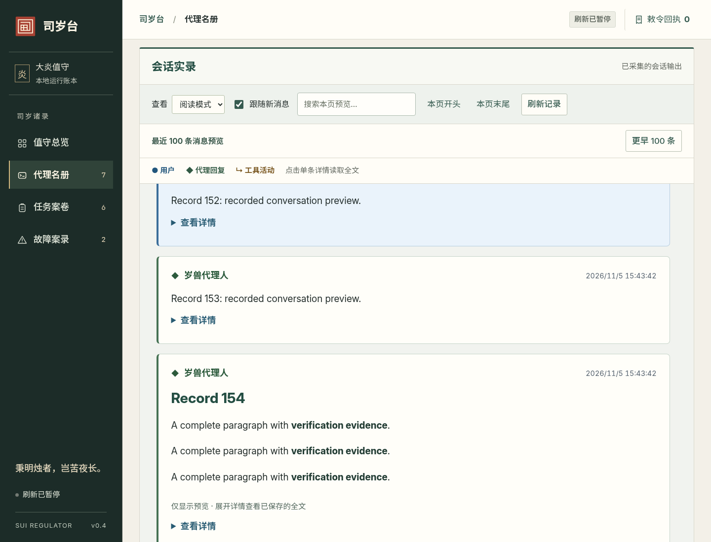
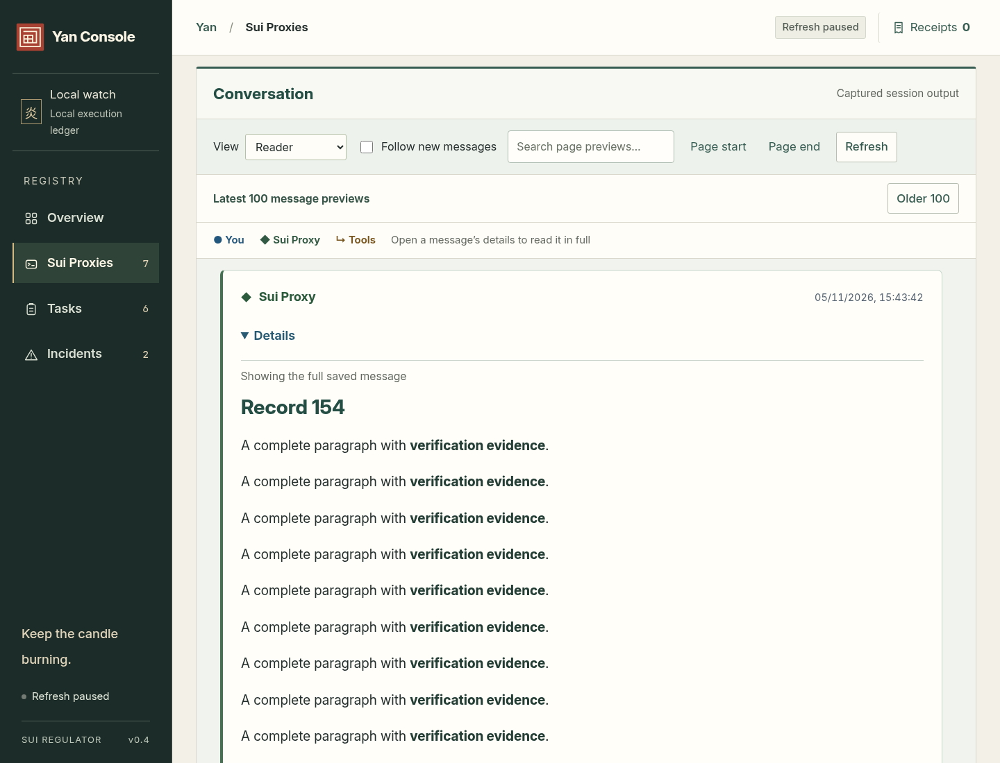

# 会话窗口与按需全文验收

2026-11-05。修复进入会话后从最早记录开始、每次刷新只补 40 个保存分段的问题。

## 使用方式

1. 打开一个 Sui Proxy：一次显示最近 100 条消息预览。相邻同消息分段先合并，工具调用和返回按 call_id 配对。
2. 点击某条“查看详情”：只读取这一条的完整已保存内容。工具和运行协议通过点击摘要展开。一次展开一条详情。
3. 详情按有界页读取，拼接后解析 Markdown，再按完整 Markdown 块分批插入页面，保持代码围栏、列表、表格和引用链接的语义。展开“原文与来源”可查看、复制原始内容。
4. 刷新或切换语言保留详情 DOM 和阅读位置。消息继续追加时提示“读取最新详情”；读取中断后可重试失败页。不会每隔五秒重新下载长正文。
5. 使用“更早 100 条”“较新一页”“回到最新”浏览历史。翻页失败保留原页；搜索仅作用于当前页预览。Controller 离线时显示最后快照和离线状态。

预览每段最多 320 字符，省略会提示“展开详情查看已保存的全文”。这与“控制台记录未完整保存”不同：后者是采集时发生的实际缺失，详情无法恢复。原有每代 4 MiB、每个原始保存分段 8000 字符的限额未变。

## 截图

所有内容均来自本地合成记录，没有调用真实 GLM。





[手机页面](latest-100-mobile.png)

## 验证

| 检查 | 结果与证据 |
| --- | --- |
| 原问题复现 | 修改前 `scripts/verify_transcript_window.py` 在“首个响应必须包含最新消息”断言失败；修改后同一真实浏览器 / HTTP / Yan RPC 路径通过 |
| 新会话窗口检查 | 16 项通过：[report.json](report.json)。155 条逻辑消息、超过 20 万字符长消息；首次一页 100 条，历史页 55 条，完整原文、4000 个加粗段落及跨保存边界代码块均核对 |
| 按需与故障处理 | 初始只有一个预览请求、无详情请求；注入第二页网络失败后续读；追加消息使用固定详情快照；页面导航后忽略迟到响应；Controller 离线保留 100 条预览 |
| 原有阅读体验 | 16 项行为检查与 144 个布局组合通过：[reading-regression.json](reading-regression.json)。覆盖角色、工具错误、GEN-001、原文、Markdown 安全渲染、双语、字号和真实指令回执 |
| Python 全套 | 198 项：187 通过、11 项可选真实 CLI 测试跳过，见 [python-tests.txt](python-tests.txt) |
| 静态检查 | Ruff、schema 导出一致性和 `git diff --check` 通过 |
| 安装包 | Wheel 构建成功，新增后端模块与三个修改的前端资源均与源码逐字节一致：[wheel.json](wheel.json) |

这次只改变读取与显示方式，复用原 Yan 查询；没有新控制命令、数据库迁移或 Session 生命周期改动。没有用这些结果宣称真实 GLM 或目标服务器已完成验收。

## 复现与部署

已有开发环境中运行：

```bash
PYTHONPATH=src .venv/bin/python -m unittest discover -v
PYTHONPATH=src .venv/bin/python scripts/verify_transcript_window.py --browser /usr/bin/chromium-browser
PYTHONPATH=src .venv/bin/python scripts/verify_console_reading.py \
  --browser /usr/bin/chromium-browser \
  --output /tmp/sui-reading-regression \
  --report docs/verification/transcript-window/reading-regression.json
.venv/bin/ruff check src tests scripts
PYTHONPATH=src .venv/bin/python scripts/export_schemas.py --check
```

浏览器脚本使用 Playwright 和本地 Chromium，自动创建并清理专用演示实例；不需要模型 API。日常运行 Console 不需要这两个测试依赖。

人工演示可运行 `PYTHONPATH=src .venv/bin/python -m sui_regulator console-demo --port 8765`，访问 `http://127.0.0.1:8765` 后打开代理会话。该内置演示记录较短，155 条记录及长消息场景由上面的专用脚本构造。

正式服务器按 [部署指南](../../DEPLOYMENT.md#最近-100-条会话预览更新2026-11-05) 安装新 release，让 Controller 与 Console 使用同一版本，再刷新浏览器。已有代理的记录可以直接读取，无需为显示更新强制换代。接口参数见 [Yan API](../../YAN_API.md)。
